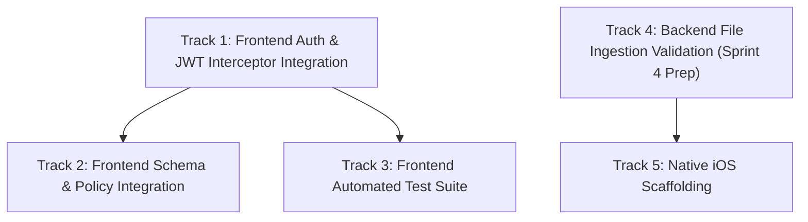

# DocuNexa — Prioritized Implementation Plan (Post-Audit)

**Date:** 2026-10-09  
**Version:** 1.0.0  
**Context:** Workstreams Unblocked Independently of PostgreSQL 16 Sandbox Provisioning  
**Author:** Principal Systems Architect & Technical Delivery Lead  

---

## 1. Planning Principles & Strategy

To maximize engineering velocity while adhering to strict safety mandates:
1. **Preserve Database Isolation:** Do not attempt migrations or database mutations against the active PostgreSQL 12.12 instance (`docunexa`).
2. **Eliminate Mock Dependencies:** Progressively replace frontend mock services with real HTTP calls targeting already implemented backend APIs.
3. **Fail-Closed Architecture:** Do not silently bypass database dependencies with process-local in-memory fallbacks in production paths.
4. **Evidence-Based Quality:** Every new feature or integration must include automated tests before sign-off.

---

## 2. Workstream Breakdown & Dependency Grouping

---

### Track 1: Real Frontend-to-Backend Authentication & JWT Interceptor (Priority: CRITICAL)
*Can proceed immediately without database setup — backend auth is active on port 8080.*

- **Objective:** Replace simulated `localStorage ('docintel-auth')` login with real HTTP calls to the backend REST API.
- **Dependencies:** None (Backend `/api/v1/auth/login` is operational).
- **Work Items:**
  1. Author `AuthInterceptor` in Angular to attach `Authorization: Bearer <accessToken>` and `X-Correlation-ID` to all outgoing requests.
  2. Implement automatic HTTP 401 interceptor that calls `POST /api/v1/auth/refresh` with refresh token rotation.
  3. Wire Angular `login.ts` form to `POST /api/v1/auth/login` with real error handling (RFC 7807 problem details).
  4. Update `roleGuard` and `authGuard` to read verified permissions and roles from the decoded JWT claims rather than mock demo roles.
- **Deliverables:** Working end-to-end login flow between Angular and Node.js.

---

### Track 2: Frontend Catalog & Policy Builder Integration (Priority: HIGH)
*Can proceed immediately — backend Sprint 3 endpoints are operational on port 8080.*

- **Objective:** Connect Angular `AdminSchemaBuilder` and `AdminDocumentTypes` to backend document type catalog and policy evaluation APIs.
- **Dependencies:** Track 1 (Authenticated HTTP client).
- **Work Items:**
  1. Replace `MockAdminService` document types methods with `GET /api/v1/document-types`.
  2. Connect Schema Builder save button to `POST /api/v1/document-types/:id/templates` and publish button to `/publish`.
  3. Wire template validation endpoint (`POST /api/v1/document-types/:id/templates/validate`) to detect dangerous ReDoS patterns directly from the UI.
  4. Wire Policy evaluation button in Admin to `POST /api/v1/policies/:id/evaluate`.
- **Deliverables:** Fully functional document type catalog and schema builder communicating with backend.

---

### Track 3: Comprehensive Frontend Automated Testing Suite (Priority: HIGH)
*Can proceed immediately — 100% self-contained in frontend.*

- **Objective:** Elevate frontend test coverage from 1 scaffolded assertion to production-grade coverage (>50 tests).
- **Dependencies:** None.
- **Work Items:**
  1. Configure Vitest test runner for Angular standalone components.
  2. Author unit tests for `authGuard`, `roleGuard`, and `AuthInterceptor`.
  3. Author unit tests for `invoice-math` reconciliation calculations and rounding tolerances.
  4. Author unit tests for Review Workbench bounding box coordinate transformations.
  5. Author unit tests for Compare Studio text redlining diff logic.
- **Deliverables:** Comprehensive frontend test suite passing in CI.

---

### Track 4: Backend File Ingestion Validation Engine (Priority: HIGH - Sprint 4 Preparation)
*Stateless backend engine preparation without database persistence.*

- **Objective:** Build and test the pre-flight file validation pipeline in Node.js before database storage.
- **Dependencies:** None (Stateless).
- **Work Items:**
  1. Implement magic-number file type validation (verifying PDF, TIFF, PNG, JPEG headers vs declared MIME types).
  2. Implement streaming SHA-256 hash generation for duplicate detection.
  3. Implement file size limit guards (50MB ceiling).
  4. Abstract the antivirus scanner interface with a clean mock adapter and ClamAV TCP streaming client.
  5. Write automated unit tests for corrupt files, oversized files, and MIME spoofing.
- **Deliverables:** Validated, test-backed ingestion engine ready to connect to MinIO/S3 and PostgreSQL once Sprint 4 is formally authorized.

---

### Track 5: Native iOS Project Scaffolding (Priority: MEDIUM)
*Can proceed independently on a macOS/Xcode workstation or as repo project templates.*

- **Objective:** Initialize the Swift / SwiftUI project structure specified in FR-019 and ADR-001.
- **Dependencies:** None.
- **Work Items:**
  1. Initialize `ios/DocuNexa` Xcode workspace.
  2. Scaffold SwiftUI app lifecycle, navigation stack, and theme tokens matching Angular design system.
  3. Build VisionKit camera document scanner view controller wrapper.
  4. Build API network client for DocuNexa REST API authentication.
- **Deliverables:** Verified native iOS project structure in repository.

---

## 3. Recommended Immediate Next Task

**RECOMMENDATION: Execute Track 1 (Real Frontend-to-Backend Authentication & JWT Interceptor Integration)**

### Justification:
1. **Zero Database Blockers:** The backend authentication service (`POST /api/v1/auth/login`, `/refresh`, `/logout`, `/me`) is already fully implemented, type-checked, running on port 8080, and validated by 65 passing automated tests.
2. **Highest Architectural Value:** Closes the single biggest architectural gap in DocuNexa — bridging the completely mock-based frontend to the real backend.
3. **Safety Compliant:** Requires zero database schema alterations, zero Docker containers, zero destructive actions, and does not violate the Sprint 4 boundary.
