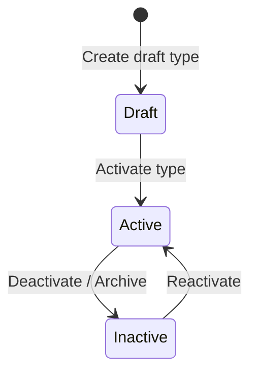

# DocuNexa Sprint 3 — Document Type Catalog Specification

## 1. Overview and BRD Alignment

The **Document Type Catalog** establishes the taxonomy and classification foundation for DocuNexa. It enables enterprise tenants to configure, maintain, and activate distinct document classes while adhering to tenant-isolation boundaries.

- **BRD Reference:** Section 4.1 (Taxonomy & Catalog Management), Section 6 (Document Intake & Categorization).
- **Core Entities:** `document_types` table, `DocumentTypeRecord` model, `SchemaService`.

---

## 2. Seeded MVP Document Types

DocuNexa seeds three baseline MVP document types with global tenant scope (`tenant_id IS NULL`):

| Type Key | Code / Display ID | Display Name | Category | Description | Status |
|---|---|---|---|---|---|
| `purchase-invoice` | `PUR-INVOICE` | Purchase Invoice | Financial | Vendor invoices and billing records containing line items, totals, and tax data. | `active` |
| `supplier-contract` | `SUP-CONTRACT` | Supplier Contract | Legal | Master service agreements, vendor statements of work, and terms agreements. | `active` |
| `internal-policy` | `INT-POLICY` | Internal Policy | Governance | Corporate SOPs, IT security policies, compliance handbooks, and bylaws. | `active` |

---

## 3. Data Model & Architecture

### Database Schema (`document_types`)

```sql
CREATE TABLE document_types (
    id VARCHAR(64) PRIMARY KEY,
    type_key VARCHAR(100) NOT NULL,
    display_name VARCHAR(255) NOT NULL,
    description TEXT,
    category VARCHAR(100) NOT NULL DEFAULT 'general',
    tenant_id VARCHAR(64) REFERENCES tenants(id) ON DELETE CASCADE,
    is_system BOOLEAN NOT NULL DEFAULT FALSE,
    status VARCHAR(50) NOT NULL DEFAULT 'active',
    active_template_version VARCHAR(32),
    created_at TIMESTAMP WITH TIME ZONE NOT NULL DEFAULT NOW(),
    updated_at TIMESTAMP WITH TIME ZONE NOT NULL DEFAULT NOW(),
    CONSTRAINT uq_doc_types_tenant_key UNIQUE (tenant_id, type_key)
);
```

### Scope Resolution
1. **Global Types (`tenant_id = NULL`):** Visible to all tenants as system-defined types. Marked `is_system = true`. System types cannot be modified or deactivated by regular tenant admins.
2. **Tenant-Specific Types (`tenant_id = '...'`):** Created by tenant administrators for organization-specific taxonomy. Strictly isolated to the owner tenant.

---

## 4. Lifecycle States



- **`draft`:** Initial creation state. Templates and extraction rules can be linked, but document ingestion cannot process documents using this type.
- **`active`:** Production state. Ingestion pipelines and classification classifiers accept and route documents under this type.
- **`inactive`:** Soft-disabled. Historical documents retain their relationship, but new document uploads cannot select this type.

---

## 5. Security & Access Control

| Action | HTTP Method | Endpoint | Required Permission | Allowed Roles |
|---|---|---|---|---|
| List types | `GET` | `/api/v1/document-types` | `schema:view` | Viewer, Editor, Approver, Tenant Admin, System Admin |
| Get type | `GET` | `/api/v1/document-types/:id` | `schema:view` | Viewer, Editor, Approver, Tenant Admin, System Admin |
| Create type | `POST` | `/api/v1/document-types` | `schema:manage` | Tenant Admin, System Admin |
| Update type | `PUT` | `/api/v1/document-types/:id` | `schema:manage` | Tenant Admin, System Admin |
| Deactivate type | `DELETE` | `/api/v1/document-types/:id` | `schema:manage` | Tenant Admin, System Admin |

### Multi-Tenant Isolation Enforcement
- When querying `document_types`, the query filter enforces:
  ```sql
  WHERE (tenant_id = :tenant_id OR tenant_id IS NULL)
  ```
- When creating or modifying a type, `tenant_id` is strictly set from the verified JWT context (`req.user.tenantId`). A tenant cannot modify a global type (`is_system = true`) or another tenant's custom type.
