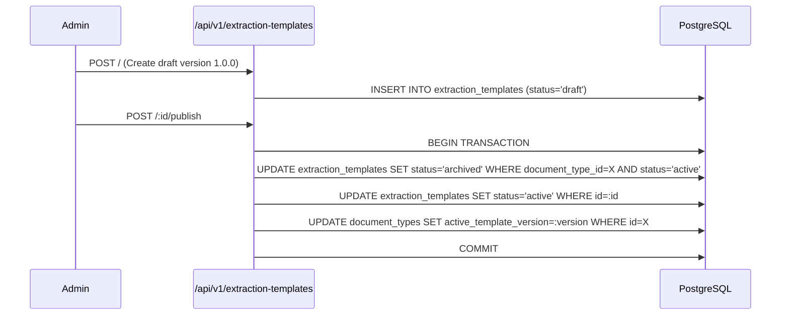

# DocuNexa Sprint 3 — Extraction Template & Field Schema Specification

## 1. Overview and BRD Alignment

The **Extraction Template & Field Schema System** defines the structural contract for OCR and information extraction engines. Each template maps to a specific `document_type_id`, specifying expected fields, constraints, data types, confidence thresholds, and ReDoS-safe validation rules.

- **BRD Reference:** Section 4.2 (Extraction Templates & Schemas), Section 6.2 (Field-Level Constraints).
- **Core Entities:** `extraction_templates` table, `TemplateField`, `ExtractionTemplateRecord`, `schema-validator.ts`.

---

## 2. Field Definition Model

DocuNexa supports strongly-typed field definitions with deterministic constraint checking.

### Supported Field Types
- `string`: Text content (e.g., vendor name, address, title).
- `number`: Numeric figures (e.g., quantities, tax rates).
- `decimal`: High-precision monetary amounts (e.g., total amount, subtotal).
- `integer`: Discrete counts (e.g., line item count, term months).
- `boolean`: Flags (e.g., tax-exempt, auto-renew).
- `date`: ISO 8601 calendar dates (`YYYY-MM-DD`).
- `datetime`: ISO 8601 timestamps (`YYYY-MM-DDTHH:mm:ssZ`).
- `enum`: Restricted set of acceptable categorical strings.
- `array`: Tabular line items or repeated sub-records.
- `object`: Nested structured composite objects.

### Field Attributes
```typescript
interface TemplateField {
  key: string;              // Machine-readable identifier (e.g., "invoice_number")
  label: string;            // Display label (e.g., "Invoice Number")
  type: FieldType;          // Data type
  required: boolean;        // Mandatory presence flag
  description?: string;     // Contextual guide for extractors/reviewers
  min_length?: number;      // String minimum character length
  max_length?: number;      // String maximum character length
  min_value?: number;       // Numeric lower bound
  max_value?: number;       // Numeric upper bound
  regex_pattern?: string;   // ReDoS-validated regular expression
  enum_values?: string[];   // Permitted values for enum fields
  sensitivity?: 'public' | 'internal' | 'confidential' | 'restricted'; // PII / compliance tier
  display_order?: number;   // Layout ordering in review UI
}
```

---

## 3. Regular Expression Denial of Service (ReDoS) Defense

Administrators may provide custom regex patterns for field validation (e.g., invoice number formatting, tax IDs). To prevent catastrophic backtracking that could crash Node.js event loops, DocuNexa implements a static ReDoS defense layer in `schema-validator.ts`:

1. **Nested Quantifier Detection:** Rejects patterns combining nested repetitions such as `(a+)+`, `(a*)*`, `([a-zA-Z]+)*`, `(a+){1,5}`.
2. **Overlapping Alternation Detection:** Rejects alternations with nested quantifiers such as `(a|a+)+`.
3. **Execution Timeouts / Safe Construction:** Tests compilation safety with safe character bounds.

```typescript
export function isSafeRegex(pattern: string): { safe: boolean; reason?: string } {
  // Reject nested quantifiers known to trigger exponential complexity
  const dangerousPatterns = [
    /\([^)]*([+*]|\{\d+,?\d*\})\)[+*]/,
    /\([^)]*\|[^)]*\)[+*]/
  ];
  for (const dp of dangerousPatterns) {
    if (dp.test(pattern)) {
      return { safe: false, reason: 'Catastrophic backtracking risk detected: nested quantifiers prohibited.' };
    }
  }
  try {
    new RegExp(pattern);
    return { safe: true };
  } catch (err: any) {
    return { safe: false, reason: `Invalid regular expression syntax: ${err.message}` };
  }
}
```

---

## 4. Template Versioning & Activation Invariants



### Invariants:
1. **Single Active Version per Scope:** Only one template per `document_type_id` and tenant scope may be `active` at any given time.
2. **Immutable Active Versions:** Once a template is marked `active`, its field definitions cannot be mutated in place. Changes require creating a new semver draft (e.g., `1.1.0` or `2.0.0`) and executing atomic activation.
3. **Document Reproducibility:** Processed documents permanently link to `template_version_id`. Historical extractions can be audited even if newer templates are activated.
