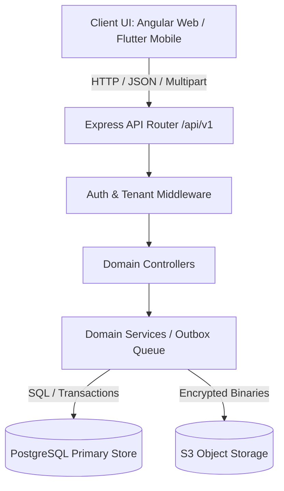

# CROSS-APPLICATION WORKFLOW MATRIX — DOCUNEXA PLATFORM

**Scope:** End-to-End Architectural Tracing Across User Roles, Angular Frontend, Express Backend, PostgreSQL Database, and Flutter Mobile Architecture.  
**Active Branch:** `mobile-frontend`  
**Audit Sprint:** Sprint 0E (Cross-Application Gap Analysis)  
**Date:** 2026-10-16  

---

## 1. Executive Summary & Flow Topology

This matrix documents the 10 core end-to-end workflows of the DocuNexa platform. For each workflow, it traces the full execution lifecycle from the user's interaction in the client application through backend routing, business service execution, transactional database persistence, and onto the planned Flutter mobile application.

---

## 2. End-to-End Workflow Specifications

### Workflow 1: Authentication, MFA, Onboarding & Session Management

- **User Roles:** Public / All Roles (Org Admin, Reviewer, Approver, Operator, Auditor, Contributor)
- **Primary Business Objective:** Authenticate user identity, enforce multi-factor authentication, manage refreshable sessions, and allow invitation acceptance without security bypasses.

| Step | Layer | Component / Handler | Route / Entity / Action | Contract / Schema | State Handling & Security Rules |
| :---: | :--- | :--- | :--- | :--- | :--- |
| **1.1** | **Angular Web** | `LoginComponent` (`login.ts`) | Route: `/login` | Inputs: `email`, `password`, `mfaCode` (optional). | Displays login card; shows loading spinner on submit. **Flaw:** Exposes demo role switcher (`DEF-010`) and local password bypass (`DEF-009`). |
| **1.2** | **Backend API** | `auth.controller.ts:loginHandler` | `POST /api/v1/auth/login` | Req: `{ email, password, mfaCode? }` Res: `200 { accessToken, refreshToken, user }` or `401 { code: 'MFA_REQUIRED', mfaToken }` | Enforces bcrypt password check; validates TOTP code if MFA enabled; generates 15-min RS256 JWT and 7-day refresh token. |
| **1.3** | **Database** | Migration 001/008 (`users`, `sessions`, `mfa_factors`) | `INSERT INTO sessions`, `SELECT * FROM users WHERE email = $1` | Tables: `users`, `sessions`, `mfa_factors`. | Updates `users.last_login_at`; records session with IP, user-agent, and hashed refresh token. |
| **1.4** | **Web Session** | `http-interceptor.ts` | LocalStorage: `token` | Injects `Authorization: Bearer <token>` on all requests. | **Flaw:** Lacks automated token refresh on 401 (`DEF-011`); logs out user abruptly. Injects dummy tokens when null. |
| **1.5** | **Flutter Mobile** | `LoginScreen`, `AuthBloc` | Route: `/login` | `AuthBloc.add(LoginRequested(email, password))` | Clean single-column layout; **omits demo role switcher and local password bypass** (DEC-006). Stores tokens in `flutter_secure_storage`. Implements `Dio` refresh interceptor (DEC-007). |

---

### Workflow 2: Document Ingestion, Antivirus Quarantine & Storage

- **User Roles:** Contributor, Reviewer, Approver, Org Admin
- **Primary Business Objective:** Accept multi-format document binaries (PDF, TIFF, PNG, DOCX up to 50MB), compute cryptographic hashes, execute antivirus scan, quarantine infected files, and queue pipeline jobs.

| Step | Layer | Component / Handler | Route / Entity / Action | Contract / Schema | State Handling & Security Rules |
| :---: | :--- | :--- | :--- | :--- | :--- |
| **2.1** | **Angular Web** | `IntakeComponent` (`intake.ts`) | Route: `/intake` | Multipart upload with drag-and-drop file picker. | Dropzone with file preview and size validation. **Flaw:** Targets `POST /api/v1/documents` (`DEF-001`), resulting in HTTP 404 in production. |
| **2.2** | **Backend API** | `intake.controller.ts:uploadDocumentHandler` | `POST /api/v1/documents/upload` | Multipart: `file`, `documentType` (optional). Res: `202 { jobId, documentId, status: 'QUEUED' }` | Validates magic bytes, verifies MIME type, checks size <= 50MB; returns 409 `DUPLICATE_DOCUMENT` if SHA-256 hash exists in tenant. |
| **2.3** | **Security / AV** | `scanner.service.ts` | ClamAV / Sandbox Scan | Scans file stream for malware signatures. | If signature detected: flags `is_quarantined = true`, blocks read access, emits high-severity security alert. |
| **2.4** | **Database** | Migration 003/005 (`documents`, `document_files`, `ingestion_batches`) | `INSERT INTO documents`, `INSERT INTO document_files` | Tables: `documents`, `document_files`, `ingestion_batches`, `outbox_events`. | Inserts document with status `QUEUED`; stores SHA-256 hash, byte length, storage key; writes event to `outbox_events` within transaction. |
| **2.5** | **Flutter Mobile** | `IntakeScreen`, `IntakeBloc` | Route: `/intake` | `IntakeBloc.add(UploadSubmitted(file, docType))` | Integrates native camera document scanner (`cunning_document_scanner`), pre-compresses to 300 DPI, targets verified endpoint `POST /api/v1/documents/upload`. Multi-file progress bars. |

---

### Workflow 3: Asynchronous OCR, Classification & Metadata Extraction

- **User Roles:** Automated System Worker / Platform Operator
- **Primary Business Objective:** Dequeue queued documents, rasterize pages at 300 DPI, execute OCR to extract text and spatial bounding boxes, classify document type, and parse schema fields.

| Step | Layer | Component / Handler | Route / Entity / Action | Contract / Schema | State Handling & Security Rules |
| :---: | :--- | :--- | :--- | :--- | :--- |
| **3.1** | **Outbox Worker** | `outbox.service.ts` / BullMQ | Transactional Outbox Dequeue | Reads `outbox_events` with status `PENDING`. | Ensures at-least-once job delivery; isolates worker failures from REST API gateway. |
| **3.2** | **OCR Pipeline** | `ocr.service.ts`, `tesseract-ocr.adapter.ts` | Page Rasterization & Text Extraction | Inputs: Image raster @ 300 DPI. Outputs: Tokens with 8-point polygons and confidence. | Deskews up to ±45°; auto-corrects orientation; generates normalized coordinates `[x1, y1, x2, y2]`. |
| **3.3** | **Classification** | `classification.service.ts` | Document Type Classifier | Evaluates OCR text tokens against document taxonomy. | Assigns `document_type_id`; if confidence < 0.70, flags `UNCERTAIN` and routes to manual triage queue. |
| **3.4** | **Extraction** | `extraction.service.ts`, `schema-validator.ts` | Layout-Aware Key-Value Extraction | Extracts dates, amounts, vendors, line items; evaluates regex and mathematical formulas. | Flags missing mandatory fields, low confidence (<85%), or arithmetic mismatches (`Subtotal + Tax != Total`). |
| **3.5** | **Database** | Migration 005/006 (`ocr_tokens`, `extracted_fields`, `bounding_boxes`) | `INSERT INTO extracted_fields`, `UPDATE documents SET processing_status = 'PENDING_REVIEW'` | Tables: `documents`, `document_pages`, `extracted_fields`, `bounding_boxes`. | Persists extracted key-values, spatial polygons, confidence scores, and transitions document status to `PENDING_REVIEW`. |
| **3.6** | **Flutter Mobile** | `DocumentDetailScreen`, `DocumentDetailBloc` | Route: `/documents/:id` | `DocumentDetailBloc.add(LoadDocumentDetail(id))` | Displays processing status pills (`QUEUED`, `PROCESSING`, `PENDING_REVIEW`); shows extraction progress and confidence gauges. |

---

### Workflow 4: Human-in-the-Loop Review Workbench & Bounding Box Correction

- **User Roles:** Reviewer, Org Admin
- **Primary Business Objective:** Present side-by-side document image and extracted form fields, permit field value corrections, visually bind fields to image coordinates, and submit human review decisions.

| Step | Layer | Component / Handler | Route / Entity / Action | Contract / Schema | State Handling & Security Rules |
| :---: | :--- | :--- | :--- | :--- | :--- |
| **4.1** | **Angular Web** | `ReviewWorkbenchComponent` (`review-workbench.ts`) | Route: `/review/:id` | 50/50 horizontal split canvas: PDF/Image canvas on left, extracted field form on right. | Clicking field centers bounding box; clicking bounding box focuses input. **Flaw:** Coordinate scaling bug in `review.service.spec.ts:181` (`DEF-007`). |
| **4.2** | **Backend API** | `review.controller.ts:getWorkbenchHandler` | `GET /api/v1/review/workbench/:id` | Res: `200 { document, fields, boundingBoxes, documentType }` | Enforces tenant boundary; checks reviewer role permissions; returns normalized coordinate polygons. |
| **4.3** | **Field Edit** | `review.controller.ts:updateFieldHandler` | `PATCH /api/v1/review/:id/fields/:key` | Req: `{ value, boundingBox? }` Res: `200 { field, updatedConfidence: 1.0 }` | Updates field value; records human correction; marks confidence as 100% human-verified. |
| **4.4** | **Decision Submit** | `review.controller.ts:submitDecisionHandler` | `POST /api/v1/review/:id/decision` | Req: `{ decision: 'APPROVE' \| 'REJECT' \| 'NEEDS_CLARIFICATION', notes }` Res: `200 { status }` | Transitions document status to `REVIEWED` or `EXCEPTION`; emits audit event with before/after diffs. |
| **4.5** | **Database** | Migration 006/012 (`review_sessions`, `extracted_fields`, `audit_events`) | `UPDATE extracted_fields`, `INSERT INTO audit_events` | Tables: `extracted_fields`, `review_sessions`, `audit_events`. | Stores updated values, user ID, timestamp, and audit trail of every manual keystroke/correction. |
| **4.6** | **Flutter Mobile** | `ReviewWorkbenchScreen`, `ReviewWorkbenchBloc` | Route: `/review/:id` | `ReviewWorkbenchBloc.add(FieldCorrected(key, value))` | **Adapts desktop split-screen to Swipeable Dual-Panel or Draggable Bottom Sheet** (DEC-008). Top 55% = `InteractiveViewer` with pinch-to-zoom; bottom 45% = field correction sheet with confidence chips. |

---

### Workflow 5: Multi-Tier Approvals, Separation of Duties & Publication

- **User Roles:** Approver, Org Admin
- **Primary Business Objective:** Route reviewed documents through sequential or parallel approval tiers, enforce strict financial Separation of Duties (preventing self-approval), record audit comments, and publish final documents.

| Step | Layer | Component / Handler | Route / Entity / Action | Contract / Schema | State Handling & Security Rules |
| :---: | :--- | :--- | :--- | :--- | :--- |
| **5.1** | **Angular Web** | `ApprovalsComponent` (`approvals.ts`) | Route: `/approvals` | Approval queue with Tier 1/2/3 tabs and approval sign-off modal. | Renders approval cards with SLA countdowns; disables approval button with warning if user uploaded/reviewed document. |
| **5.2** | **Backend API** | `approval.controller.ts:submitDecisionHandler` | `POST /api/v1/approvals/:id/decision` | Req: `{ decision: 'APPROVED' \| 'REJECTED', comments }` Res: `200 { approvalStatus, nextTier? }` | **Separation of Duties (SoD) Guard:** Rejects with HTTP 403 `SOD_VIOLATION` if `userId == uploaderId || userId == reviewerId`. Mandatory comments for rejections. |
| **5.3** | **Tier Routing** | `approval.service.ts` | Multi-tier Threshold Evaluator | If Total > $50k: routes to Executive Approver. If approved at final tier: transitions document to `PUBLISHED`. | Generates digital signature record with user ID, IP address, timestamp, and cryptographic approval checksum. |
| **5.4** | **Database** | Migration 008/013 (`approval_requests`, `approval_steps`, `documents`) | `UPDATE approval_requests`, `UPDATE documents SET processing_status = 'PUBLISHED'` | Tables: `approval_requests`, `approval_steps`, `documents`, `audit_events`. | Persists approval decision; updates document state to `PUBLISHED`; emits publication webhook event. |
| **5.5** | **Flutter Mobile** | `ApprovalsQueueScreen`, `ApprovalsBloc` | Route: `/approvals` | `ApprovalsBloc.add(SubmitApprovalDecision(id, 'APPROVED'))` | Card-based approval queue with swipe actions (swipe right = approve, swipe left = reject). Approval requires confirmation bottom sheet with biometric/PIN prompt; SoD guard enforced. |

---

### Workflow 6: Document Version Comparison & Clause Diffing

- **User Roles:** Reviewer, Approver, Org Admin, Auditor
- **Primary Business Objective:** Compare two versions of a document or two contract files, compute word-level redlining, identify altered clauses, and present side-by-side or unified diffs.

| Step | Layer | Component / Handler | Route / Entity / Action | Contract / Schema | State Handling & Security Rules |
| :---: | :--- | :--- | :--- | :--- | :--- |
| **6.1** | **Angular Web** | `CompareStudioComponent` (`compare-studio.ts`) | Route: `/compare/:id` | Side-by-side desktop diff viewer with additions (green), deletions (red), and clause navigation sidebar. | Allows selecting Version A vs Version B; highlights modified numerical figures and altered legal clauses. |
| **6.2** | **Backend API** | `compare.controller.ts:compareHandler` | `POST /api/v1/compare` | Req: `{ baseDocumentId, targetDocumentId }` Res: `200 { similarityScore, diffs: [...], summary }` | Executes Myers diff algorithm on OCR text spans; aligns extracted fields; computes semantic similarity score. |
| **6.3** | **Database** | Migration 009/016 (`document_comparisons`, `comparison_diffs`) | `INSERT INTO document_comparisons` | Tables: `document_comparisons`, `comparison_diffs`. | Persists comparison run, similarity score, clause diff JSON payload, and plain-English summary. |
| **6.4** | **Flutter Mobile** | `CompareSelectorScreen`, `CompareDiffScreen`, `CompareBloc` | Route: `/compare` & `/compare/:id` | `CompareBloc.add(ExecuteCompare(baseId, targetId))` | **Adapts desktop side-by-side to Unified Diff View or Tabbed Toggle** (Document A / Document B / Unified Diff). Color-coded diff chips, clause change summary card at top. |

---

### Workflow 7: Semantic/Keyword Search & Grounded Conversational Q&A

- **User Roles:** All Authenticated Roles (Tenant-scoped)
- **Primary Business Objective:** Allow hybrid search (full-text BM25 + pgvector semantic cosine similarity) and natural language questions with strict citation grounding and abstention.

| Step | Layer | Component / Handler | Route / Entity / Action | Contract / Schema | State Handling & Security Rules |
| :---: | :--- | :--- | :--- | :--- | :--- |
| **7.1** | **Angular Web** | `SearchComponent` & `QaComponent` | Routes: `/search`, `/qa` | Search: search bar with filter chips; Q&A: chat interface with citation preview popovers. | Search results show highlighted text snippets. Q&A answers include clickable citation tags. |
| **7.2** | **Backend API** | `search.controller.ts:searchHandler`, `qa.controller.ts:askHandler` | `GET/POST /api/v1/search`, `POST /api/v1/qa/ask` | Search: `{ query, mode, filters }` QA: `{ question, documentIds? }` Res: `200 { answer, citations: [...], abstain }` | **Groundedness Rule:** Strict citation verification; if answer cannot be verified from document chunks, returns `abstain: true`. Enforces tenant document isolation. |
| **7.3** | **Database** | Migration 010/015 (`document_embeddings`, `qa_sessions`, `qa_citations`) | `SELECT ... ORDER BY embedding <=> $1 LIMIT 5` | Tables: `document_embeddings` (pgvector), `qa_sessions`, `qa_citations`. | Queries vector cosine distance on 1536-dim embeddings; joins with `documents` table to filter by caller `tenant_id`. |
| **7.4** | **Flutter Mobile** | `SearchScreen`, `QaChatScreen`, `SearchBloc`, `QaBloc` | Routes: `/search`, `/qa` | `SearchBloc.add(QuerySubmitted(query))`, `QaBloc.add(SendMessage(text))` | Mobile search with voice input and filter chips; conversational chat UI with assistant messages and tappable citation pills. Tapping citation pans to exact coordinates on document. |

---

### Workflow 8: Tenant Administration, Role Assignment & Invitations

- **User Roles:** Organization Admin, Platform Operator
- **Primary Business Objective:** Manage tenant users, issue role-scoped invitations, revoke access, and configure organizational security policies.

| Step | Layer | Component / Handler | Route / Entity / Action | Contract / Schema | State Handling & Security Rules |
| :---: | :--- | :--- | :--- | :--- | :--- |
| **8.1** | **Angular Web** | `AdminUsersComponent` (`admin-users.ts`) | Route: `/admin/users` | User directory table with role dropdowns, active/inactive switches, and "Invite User" modal. | Renders user list with role badges; prevents admin from deactivating their own account. |
| **8.2** | **Backend API** | `user.controller.ts:inviteUserHandler`, `updateUserRoleHandler` | `POST /api/v1/users/invite`, `PATCH /api/v1/users/:id/role` | Invite: `{ email, role }` Update: `{ role }` Res: `200 { invitationId, token, expiresAt }` | Enforces `requireRole(['org_admin', 'platform_operator'])`; validates email domain; generates secure 48-hour invitation token. |
| **8.3** | **Database** | Migration 001/002 (`users`, `user_invitations`, `audit_events`) | `INSERT INTO user_invitations`, `UPDATE users SET role = $1` | Tables: `users`, `user_invitations`, `audit_events`. | Updates user role within tenant; logs administrative action to audit table with IP and admin user ID. |
| **8.4** | **Flutter Mobile** | `UserDirectoryScreen`, `UserManagementBloc` | Route: `/admin/users` | `UserManagementBloc.add(InviteUser(email, role))` | Searchable user directory with role selector bottom sheet and FAB to invite new user. Tenant-scoped validation. |

---

### Workflow 9: Document Retention Schedules, Legal Holds & Secure Purge

- **User Roles:** Organization Admin, Compliance Auditor
- **Primary Business Objective:** Enforce regulatory retention periods, freeze purge countdowns during litigation with Legal Holds, and execute permanent zero-fill purges with cryptographic deletion certificates.

| Step | Layer | Component / Handler | Route / Entity / Action | Contract / Schema | State Handling & Security Rules |
| :---: | :--- | :--- | :--- | :--- | :--- |
| **9.1** | **Angular Web** | `AdminRetentionComponent` (`admin-retention.ts`) | Route: `/admin/retention` | Retention policy table, active legal holds toggle, and purge execution modal. | Countdown timers show days until purge eligibility; active legal hold displays lock badge. |
| **9.2** | **Backend API** | `retention.controller.ts:applyHoldHandler`, `purgeHandler` | `POST /api/v1/retention/holds`, `POST /api/v1/retention/purge` | Hold: `{ documentId, reason, caseNumber }` Purge: `{ documentId, confirmationKey }` | **Legal Hold Rule:** Rejects purge request with HTTP 423 `LOCKED_UNDER_LEGAL_HOLD` if document has active hold. Requires admin credential re-verification. |
| **9.3** | **Database** | Migration 014/021 (`retention_policies`, `legal_holds`, `purge_certificates`) | `INSERT INTO legal_holds`, `DELETE FROM documents`, `INSERT INTO purge_certificates` | Tables: `documents`, `legal_holds`, `purge_certificates`, `audit_events`. | On purge: removes document metadata and binary references; inserts cryptographic certificate with SHA-256 deletion proof and timestamp. |
| **9.4** | **Flutter Mobile** | `RetentionPoliciesScreen`, `RetentionAdminBloc` | Route: `/admin/retention` | `RetentionAdminBloc.add(SetLegalHold(id, reason))` | Mobile view of retention schedules; allows emergency Legal Hold activation from mobile device. Purge operations restricted to web or require multi-factor prompt. |

---

### Workflow 10: System Telemetry, Outbox Pipeline & Job Retry

- **User Roles:** Platform Operator, Organization Admin
- **Primary Business Objective:** Monitor background processing pipelines, track dead letter queues, inspect system telemetry, and manually retry failed ingestion jobs.

| Step | Layer | Component / Handler | Route / Entity / Action | Contract / Schema | State Handling & Security Rules |
| :---: | :--- | :--- | :--- | :--- | :--- |
| **10.1** | **Angular Web** | `AdminOperationsComponent`, `AdminTelemetryComponent` | Routes: `/admin/operations`, `/admin/overview` | Queue depth gauges, dead-letter job table with "Retry All" and "Inspect Error" actions. | Pulls real-time queue statistics; displays pipeline throughput velocity and error breakdowns. |
| **10.2** | **Backend API** | `health.controller.ts`, `document.controller.ts:retryHandler` | `GET /api/v1/health/ready`, `POST /api/v1/documents/:id/retry` | Res: `200 { status: 'READY', checks: { postgres: 'UP', redis: 'UP' } }` | Enforces operator authorization; resets document processing status to `QUEUED`; writes retry event to outbox. |
| **10.3** | **Database** | Migration 003/007 (`documents`, `outbox_events`, `system_metrics`) | `UPDATE documents SET processing_status = 'QUEUED', retry_count = retry_count + 1` | Tables: `documents`, `outbox_events`, `system_metrics`. | Increments retry counter; re-enqueues processing outbox event; updates error log. |
| **10.4** | **Flutter Mobile** | `AdminTelemetryScreen`, `OperationsDashboardScreen`, `OperationsBloc` | Routes: `/admin/telemetry`, `/admin/operations` | `OperationsBloc.add(RetryJob(documentId))` | Clean mobile telemetry dashboard: service health badges (Postgres, Redis, Workers); dead-letter card list with one-tap retry button. |

---

## 3. Workflow Parity & State Coverage Analysis

| Workflow # | Name | Web Implementation | Backend Implementation | Database Persistence | Mobile Feasibility & Strategy | State Coverage (Loading/Empty/Error/Offline) |
| :---: | :--- | :---: | :---: | :---: | :--- | :---: |
| **W1** | Auth, MFA & Sessions | Complete | Verified (Sprint 0D) | Complete | **Full Parity:** Strip web bypasses; implement Dio refresh queue. | ✅ Full (Shimmer, Form Errors, Offline banner) |
| **W2** | Ingestion & Quarantine | Defect (DEF-001) | Verified (Route `/upload`) | Complete | **Enhanced Parity:** Native camera edge detection & 300 DPI compression. | ✅ Full (Upload progress bar, Collision sheet) |
| **W3** | OCR, Classification & Extraction | Complete | Verified | Complete | **Full Parity:** Pipeline status monitoring and extracted field display. | ✅ Full (Status stepper, Skeletons) |
| **W4** | Review Workbench | Complete | Verified (DEF-007 scaling) | Complete | **Adapted Parity:** Swipeable dual-panel or draggable bottom sheet. | ✅ Full (Pinch-zoom, Field focus, Undo) |
| **W5** | Approvals & SoD | Complete | Verified | Complete | **Full Parity:** Swipe-to-approve/reject with confirmation sheet. | ✅ Full (Empty queue state, SoD alerts) |
| **W6** | Version Comparison | Complete | Verified | Complete | **Adapted Parity:** Unified diff toggle replacing side-by-side. | ✅ Full (Diff summary card, Syntax highlighting) |
| **W7** | Search & Grounded Q&A | Complete | Verified | Complete | **Full Parity:** Voice input, conversational chat, citation taps. | ✅ Full (Typing indicators, Groundedness badges) |
| **W8** | Tenant Administration | Complete | Verified | Complete | **Adapted Parity:** User directory and role assign; invitations. | ✅ Full (Search filter, Role selector sheet) |
| **W9** | Retention & Purge | Complete | Verified | Complete | **Adapted Parity:** Policy view & Legal Hold toggle; purge web-only. | ✅ Full (Legal hold lock pill, Warning modals) |
| **W10**| Telemetry & Operations | Complete | Verified | Complete | **Adapted Parity:** Service health cards, failed job retry list. | ✅ Full (Pull-to-refresh, Retry spinners) |
