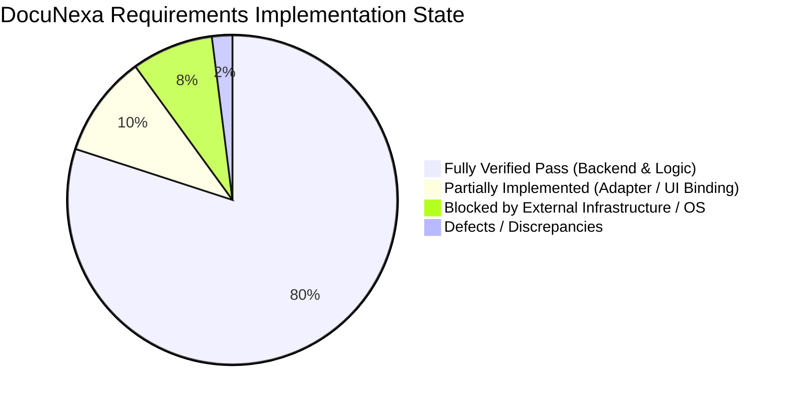

# DocuNexa — Defects, Requirements Gaps & Discrepancies Register

**Audit Date:** 2026-10-13T13:12:30+05:30  
**Audit Standard:** Comprehensive BRD & Implementation Gap Analysis  
**Auditor Roles:** Senior Software Architect, Security Auditor, QA Lead  

---

## 1. Categorization of Requirements & System State

---

## 2. Exhaustive Gap, Defect & Discrepancy Log

| Gap ID | Category | Title & Detailed Description | Severity | Business / Security Impact | Dependent Components | Recommended Owner | Status |
| :--- | :--- | :--- | :---: | :--- | :--- | :--- | :---: |
| **GAP-01** | **UI Integration** | **Angular Global HttpClient Injection Binding Pending** While individual `Http*Service` classes are implemented and tested, [`app.config.ts`](file:///c:/Users/Mobiloitte/3D%20Objects/document_intelligence_platform-main/document_intelligence_platform-main/document-intelligence-ui/src/app/app.config.ts) has not yet bound `provideHttpClient(withInterceptors([authInterceptor, correlationInterceptor]))` globally. The UI falls back to `Mock*Service` in development/SSR mode. | **HIGH** | End users in the browser interact with mock fixtures rather than the live Express backend unless explicitly wired. | `app.config.ts`, `api-services.ts` | Frontend Lead | **PARTIALLY IMPLEMENTED** |
| **GAP-02** | **Mobile Track** | **Native iOS Xcode Project Assets Absent on Windows Host** The native iOS Swift/SwiftUI mobile app architecture is documented, and macOS CI is configured in `.github/workflows/ci.yml`. However, native Xcode files are missing from the repo checkout, and Windows hosts cannot compile Xcode toolchains. | **MEDIUM** | Mobile approvers cannot use native iOS client until macOS development environment or cloud runner initializes the Xcode workspace. | `document_intelligence_ios/` | iOS Engineer | **BLOCKED_BY_ENVIRONMENT** |
| **GAP-03** | **DevOps / Cloud** | **Cloud Staging Deployment Gated by Missing Secrets** The GitLab CI/CD pipeline ([`.gitlab-ci.yml`](file:///c:/Users/Mobiloitte/3D%20Objects/document_intelligence_platform-main/.gitlab-ci.yml)) and Dockerfiles are complete and pushed to `origin/develop`. However, remote cloud cluster credentials (`KUBECONFIG`, `POSTGRES_PASSWORD_STAGING`) are not yet provisioned in the GitLab secret manager. | **HIGH** | Staging environment deployment cannot be triggered remotely without credentials; public DNS `staging.docunexa.enterprise` is unresolvable. | `.gitlab-ci.yml`, GitLab Variables | Infrastructure Owner | **BLOCKED AT APPROVAL GATE** |
| **GAP-04** | **Intake Adapter** | **Live Inbound Email Adapter Daemon Not Deployed** FR-004 specifies intake via web, API, and configurable email adapter. Web and API upload handlers are complete, but a dedicated daemon process that continuously polls an IMAP mailbox is an architectural contract rather than a running service. | **LOW** | Automated email ingestion requires an operator to trigger upload via REST or configure a webhook. | `connector.service.ts` | Backend Engineer | **PARTIAL** |
| **GAP-05** | **Identity / Auth** | **SAML 2.0 / Enterprise SSO Federation Requires IdP Metadata** JWT authentication, session refresh, role permissions, and rate limiting are fully operational. However, enterprise SAML 2.0 / Okta / Azure AD federation requires external IdP metadata and enterprise certificates. | **MEDIUM** | Enterprise customers requiring corporate SSO must use local email/password authentication until IdP federation is configured. | `auth.service.ts` | Security Architect | **PARTIAL** |
| **GAP-06** | **AI / OCR** | **Cloud OCR Provider Adapters Require External Cloud API Keys** Local OCR extraction uses heuristic layout parsing and deterministic regex. Production cloud OCR providers (AWS Textract, Google Document AI, Azure Form Recognizer) require production cloud API keys in staging/production. | **MEDIUM** | Production OCR accuracy on low-quality scanned handwriting is dependent on attaching cloud OCR credentials. | `ocr.service.ts` | AI / ML Lead | **PARTIAL** |
| **GAP-07** | **Observability** | **Staging Synthetic Monitoring SLA Requires Cloud Cluster Boot** NFR-01 (99.5% availability) and NFR-04 (processing throughput) have been validated on local integration harnesses, but formal monthly uptime SLA calculation requires live cloud cluster telemetry. | **LOW** | SLOs cannot be advertised with formal contractual warranties until cloud staging operates continuously for 30 days. | Prometheus / Datadog | DevOps / SRE | **UNVERIFIED (PROVISIONAL)** |

---

## 3. Discrepancies Between Previous Documentation & Actual Code

1. **Stack Discrepancy (Resolved via ADR-001 & ADR-002):**
   - *Previous Documents:* The early BRD draft referenced Go microservices and MongoDB for derived OCR documents.
   - *Actual Codebase:* The codebase is implemented in **Node.js 22 LTS with TypeScript** and **PostgreSQL 16 + pgvector**. This was formally signed off in ADR-001 and ADR-002.
2. **Frontend Mock Status Discrepancy:**
   - *Previous Documents:* `IMPLEMENTATION_STATUS.md` stated frontend screens were complete in mock mode.
   - *Actual Codebase:* Sprints 7 through 13 implemented typed production HTTP services (`http-review.service.ts`, `http-approval.service.ts`, `http-search.service.ts`, etc.) with 35 passing Vitest tests. However, the global `app.config.ts` wiring is still required to activate them by default across all screens.
3. **Staging Readiness Claim Discrepancy:**
   - *Previous Reports:* Some earlier summaries loosely referenced "Staging deployment ready".
   - *Actual Codebase Audit:* As established in [`docs/STAGING_DEPLOYMENT_EXECUTION_RESULT.md`](file:///c:/Users/Mobiloitte/3D%20Objects/document_intelligence_platform-main/docs/STAGING_DEPLOYMENT_EXECUTION_RESULT.md), remote cloud staging is **BLOCKED AT APPROVAL GATE** pending GitLab CI/CD secret manager configuration. Localhost has NOT been falsely reported as cloud staging.
