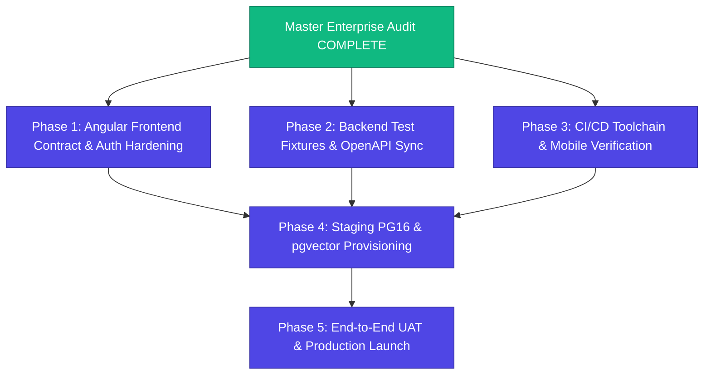

# DOCUNEXA — ENTERPRISE REMEDIATION ROADMAP
**Phased Implementation Plan for Production Release Readiness**

**Document Version:** 1.0  
**Audit Reference:** `DOCUNEXA_MASTER_ENTERPRISE_AUDIT.md`  
**Date:** 2026-10-17  
**Authorization Policy:** Each phase must be separately authorized and independently verified before proceeding to subsequent phases. Implementations must NOT begin until explicit stakeholder approval is granted.

---

## 1. Roadmap Architecture & Execution Principles

### Mandatory Execution Rules
1. **Separation of Concerns:** Each phase delivers self-contained, testable units without creating cross-phase circular dependencies.
2. **Zero Regressions:** Every phase mandates running the existing automated test suites before and after modifications.
3. **No In-Memory Fallbacks:** All persistent operations must target durable data stores.
4. **Independent Exit Gates:** Advancing past any phase requires achieving an explicit `PASS` on that phase's exit gate.

---

## 2. Phase 1: Angular Frontend Contract & Auth Hardening

### 2.1 Scope & Objectives
Address all confirmed frontend API contract mismatches, security bypasses, and session renewal deficiencies identified in `AUDIT_02_ANGULAR_FRONTEND.md`:
- Fix document upload endpoint URL mismatch (`DEF-001` - P0).
- Eliminate client-side password validation fallback (`DEF-009` - P1).
- Strip demo role quick-switcher from production templates (`DEF-010` - P1).
- Implement synchronized silent token refresh in HTTP interceptor (`DEF-011` - P1).
- Remove arbitrary document deletion endpoint call or wire to retention schedule request (`DEF-003` - P2).

### 2.2 Prerequisites
- Explicit authorization for Phase 1.
- Active branch: `mobile-frontend` or dedicated PR branch `fix/frontend-contract-hardening`.

### 2.3 Detailed Work Items & Files
1. **Upload Endpoint Correction:**
   - File: `document_intelligence_platform-main/document-intelligence-ui/src/app/core/services/http-document.service.ts`
   - Change: Line 114, update `POST /documents` to `POST /documents/upload`.
2. **Strip Client-Side Auth Bypass:**
   - File: `document_intelligence_platform-main/document-intelligence-ui/src/app/core/services/auth.ts`
   - Change: Remove `if (password === 'password123' || password.length >= 6)` block; set client state strictly upon successful backend JWT response.
3. **Remove Demo Role Quick-Switcher:**
   - File: `document_intelligence_platform-main/document-intelligence-ui/src/app/features/auth/login/login.ts`
   - Change: Remove `loginByRole` demo buttons from template markup and component code.
4. **Implement Queued Token Refresh Interceptor:**
   - File: `document_intelligence_platform-main/document-intelligence-ui/src/app/core/api/http-interceptor.ts`
   - Change: Intercept HTTP 401; buffer pending requests while dispatching `POST /api/v1/auth/refresh`; retry buffered requests upon success; redirect to `/login` only upon refresh failure.
5. **Document Deletion Handling:**
   - File: `document_intelligence_platform-main/document-intelligence-ui/src/app/core/services/http-document.service.ts`
   - Change: Replace `DELETE /documents/:id` with retention schedule request or display compliance dialog.

### 2.4 Acceptance Criteria & Verification
- Document ingestion via web UI uploads successfully to `/api/v1/documents/upload` (HTTP 200/201).
- Access tokens nearing expiration refresh silently without user logout.
- No demo role switcher appears in login UI.
- All 71 Angular Vitest tests pass cleanly.

### 2.5 Phase Deliverable & Exit Gate
- **Deliverable:** `FRONTEND_HARDENING_VERIFICATION_REPORT.md`
- **Exit Gate:** Angular Frontend Audit Gate: `PASS`

---

## 3. Phase 2: Backend Test Fixtures & OpenAPI Specification Sync

### 3.1 Scope & Objectives
Resolve the 3 failing backend test suites identified in `AUDIT_01_BACKEND.md` and synchronize the OpenAPI 3.1 schema:
- Update review service unit test coordinate assertion to match normalized ratio scaling (`DEF-007` - P2).
- Update user MFA versioning test fixture to supply required `currentCode` on re-enrollment (`DEF-016` - P2).
- Add the 6 missing Express endpoints to `openapi.yaml` (`DEF-015` - P1).

### 3.2 Prerequisites
- Explicit authorization for Phase 2.
- PostgreSQL 12 test instance running on port 5433.

### 3.3 Detailed Work Items & Files
1. **Coordinate Scaling Assertion Update:**
   - File: `document_intelligence_platform-main/backend/src/services/review.service.spec.ts`
   - Change: Line 181, adjust expectation from raw pixel `120` to normalized coordinate ratio `3.64`.
2. **MFA Test Fixture Parameter:**
   - File: `document_intelligence_platform-main/backend/src/services/user-mfa-versioning.spec.ts`
   - Change: Tests #7 and #8, supply valid current TOTP code or recovery code during re-enrollment call.
3. **OpenAPI 3.1 Schema Declarations:**
   - File: `document_intelligence_platform-main/backend/openapi.yaml`
   - Change: Declare schemas and paths for:
     - `POST /api/v1/auth/change-password`
     - `GET /api/v1/auth/sessions`
     - `DELETE /api/v1/auth/sessions/{id}`
     - `GET /api/v1/users/profile`
     - `POST /api/v1/users/profile/avatar`
     - `GET /api/v1/users/profile/avatar/{filename}`

### 3.4 Acceptance Criteria & Verification
- `npm test` inside `backend/` passes **100% of test suites (58/58)** and **100% of tests (634/634)**.
- `openapi-routes.spec.ts` passes with zero discrepancies between Express router and `openapi.yaml`.

### 3.5 Phase Deliverable & Exit Gate
- **Deliverable:** `BACKEND_TEST_AND_SPEC_REPORT.md`
- **Exit Gate:** Backend Audit Gate: `PASS`

---

## 4. Phase 3: CI/CD Toolchain & Mobile Runtime Verification

### 4.1 Scope & Objectives
Address toolchain blocker `BLK-001` and establish automated mobile CI/CD pipelines:
- Provision Flutter 3.22.x+ and Android SDK tools in CI/CD environment (GitHub Actions or local agent).
- Execute `flutter test` across all 210 authored unit, BLoC, and widget tests.
- Execute `flutter analyze` for static code quality verification.
- Scaffold iOS runner targets (`Runner.xcworkspace`) for cross-platform completion (`MOB-003`).
- Build release Android Application Bundle (`.aab`) with R8 / ProGuard enabled.

### 4.2 Prerequisites
- Workstation or CI runner with Flutter 3.22.x+ and Java 17+ installed.
- Android Keystore signing key for release builds.

### 4.3 Detailed Work Items
1. **CI Pipeline Configuration:**
   - File: `.github/workflows/mobile-ci.yml`
   - Configure steps: `subosito/flutter-action@v2`, `flutter pub get`, `flutter analyze`, `flutter test --coverage`, `flutter build appbundle`.
2. **Execute Full Mobile Test Suite:**
   - Run `flutter test` across `mobile/test/` (54 test files, 210 tests).
3. **Scaffold iOS Project Targets:**
   - Execute `flutter create . --platforms=ios` inside `mobile/`.
4. **Native Push Notification Adapter Integration (`MOB-002`):**
   - Configure Firebase project, add `google-services.json`, implement background message receiver.

### 4.4 Acceptance Criteria & Verification
- All 210 Flutter tests executed with 100% pass rate recorded in CI artifacts.
- Zero fatal errors in `flutter analyze`.
- Production release AAB built cleanly with ProGuard shrinking verified.

### 4.5 Phase Deliverable & Exit Gate
- **Deliverable:** `MOBILE_RUNTIME_VERIFICATION_REPORT.md`
- **Exit Gate:** Flutter Mobile Audit Gate: `PASS`

---

## 5. Phase 4: Staging Environment Baseline & PostgreSQL 16 Provisioning

### 5.1 Scope & Objectives
Upgrade persistence layer from local development PostgreSQL 12.12 to the approved production architecture baseline:
- Provision PostgreSQL 16 with official `pgvector` extension on port 5434.
- Apply all 34 database migrations cleanly.
- Verify IVFFlat / HNSW cosine distance vector indexing for semantic search and grounded Q&A.
- Validate transactional outbox delivery and connection pool under simulated load.

### 5.2 Prerequisites
- Staging host or Docker container with PostgreSQL 16 + pgvector image (`pgvector/pgvector:pg16`).
- Review of `docs/POSTGRESQL_16_PGVECTOR_PROVISIONING_PLAN.md`.

### 5.3 Detailed Work Items
1. **Containerized PG16 Provisioning:**
   - Deploy Docker container using `pgvector/pgvector:pg16` on port 5434.
2. **Execute Migrations:**
   - Run Sequelize migrations `001-initial-schema.sql` through `034-fix-tenant-document-types.sql`.
3. **Enable pgvector Indexing:**
   - Create vector embeddings column: `ALTER TABLE document_pages ADD COLUMN embedding vector(1536);`
   - Create HNSW index: `CREATE INDEX idx_pages_embedding ON document_pages USING hnsw (embedding vector_cosine_ops);`
4. **Disaster Recovery Drill:**
   - Rehearse backup and restore drill adhering to BRD target (RPO 24h, RTO 8h).

### 5.4 Acceptance Criteria & Verification
- All 34 migrations execute without syntax errors or constraint violations.
- Vector search latency p95 < 1.0 second under 100 concurrent queries (`NFR-02`).
- RPO $\le$ 24 hours, RTO $\le$ 8 hours verified via restore drill (`NFR-05`).

### 5.5 Phase Deliverable & Exit Gate
- **Deliverable:** `POSTGRESQL_16_STAGING_VERIFICATION_REPORT.md`
- **Exit Gate:** Database Infrastructure Gate: `PASS`

---

## 6. Phase 5: End-to-End Enterprise System Verification & Release

### 6.1 Scope & Objectives
Conduct end-to-end user acceptance testing across the fully unified multi-tier platform (Angular + Mobile + Backend + PG16 + Redis + MinIO + MongoDB):
- Execute acceptance scenarios `UAT-01` through `UAT-12` defined in BRD Section 16.
- Conduct simulated adversarial security assessment (prompt injection, tenant IDOR, token replay).
- Perform load and performance validation against NFR targets.

### 6.2 Acceptance Scenarios (BRD Section 16)
1. **UAT-01:** Admin configures invoice template, reviewer, approver, and validation rules.
2. **UAT-02:** Contributor uploads clean invoice and scanned contract; scan, OCR, classification, and page evidence render.
3. **UAT-03:** Invoice with mismatched totals flags arithmetic discrepancy; duplicate document flags warning without silent overwrite.
4. **UAT-04:** Reviewer corrects supplier/date; approver completes decision; audit ledger records decision.
5. **UAT-05:** Revised contract uploaded; user compares versions; clause diffs show side-by-side citations.
6. **UAT-06:** Reader asks Q&A question; answer cites permitted version; unsupported portion abstains.
7. **UAT-07:** Prompt injection attempt inside uploaded document is ignored; cross-tenant content is excluded.
8. **UAT-08:** Revoked user session cannot access API, download files, or fetch Q&A citations.
9. **UAT-09:** OCR failure on damaged page marks page as failed and provides manual entry fallback.
10. **UAT-10:** Worker failure retries safely via DLQ without duplicate ERP posting.
11. **UAT-11:** Legal hold placed on document blocks retention purge schedule until authorized release.
12. **UAT-12:** Load test verifies 99.5% availability and sub-second metadata search.

### 6.3 Phase Deliverable & Exit Gate
- **Deliverables:**
  - `FINAL_ENTERPRISE_ACCEPTANCE_REPORT.md`
  - Production Deployment & Operations Runbook
  - Stakeholder Sign-Off Matrix
- **Exit Gate:** Overall Platform Release Gate: **`PASS` (Production Launch Authorized)**
