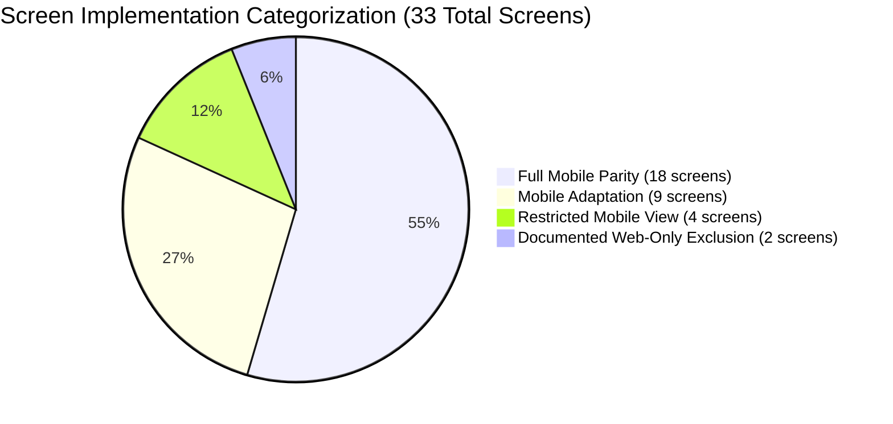

# FLUTTER MOBILE PARITY GAP ANALYSIS — DOCUNEXA PLATFORM

**Scope:** Analysis of Mobile Feature Parity, Desktop-to-Mobile UX Adaptations, Platform Exclusions, and Mobile Architecture Specifications.  
**Source Web Application:** `document-intelligence-ui` (14 Feature Modules, 33 Views, 27 Services)  
**Target Mobile App:** DocuNexa Mobile (Flutter / Dart, Android First)  
**Active Branch:** `mobile-frontend`  
**Audit Sprint:** Sprint 0E (Cross-Application Gap Analysis)  
**Date:** 2026-10-16  

---

## 1. Executive Summary & Categorization

To deliver a high-productivity mobile experience on phone form factors, DocuNexa's 33 desktop web views are categorized into four distinct implementation tiers:

1. **Full Mobile Parity (18 Screens / 54.5%):** Directly mapped with identical business logic, authentication boundaries, and state management (e.g., Login, Verify Email, Dashboard, Document Catalog, Document Detail, Review Queue, Approvals Queue, Search, Q&A Chat, Task Management, User Profile).
2. **Mobile Adaptation (9 Screens / 27.3%):** Re-architected desktop paradigms (50/50 split canvas, multi-column tables, side-by-side diffs) into ergonomic touch-first patterns (e.g., Review Workbench with Draggable Bottom Sheet, Unified Version Diff Viewer, Analytics Cards with `fl_chart`, File Picker with Camera Scanner).
3. **Restricted Mobile View (4 Screens / 12.1%):** High-level administrative views providing monitoring, status inspection, and emergency toggles, with destructive or batch configurations restricted (e.g., Admin Telemetry, User Directory, Retention Governance with Legal Hold toggle, Operations Queue monitor).
4. **Documented Web-Only Exclusion (2 Screens / 6.1%):** Excluded from mobile phone scope due to extreme screen density requirements and complex visual desktop tooling (Visual Document Type Schema Builder & Drag-and-Drop Form Designer; Webhook Advanced Custom Header/Payload Scripting).

---

## 2. Complete Screen Categorization & Parity Rationale

| # | Screen Name & Route | Parity Category | Desktop Paradigm | Mobile Architectural Adaptation | Rationale & User Persona Fit |
| :-: | :--- | :---: | :--- | :--- | :--- |
| **1** | `/login` (Login) | **Full Parity** | Centered login card, demo role buttons, password bypass. | Clean single-column layout, biometric prompt (`local_auth`), strict backend auth. **Omit demo buttons and client bypasses.** | Primary authentication entrypoint for all mobile users. |
| **2** | `/verify-email` (VerifyEmail) | **Full Parity** | 6-box input with resend button. | 6-digit numeric auto-focusing OTP pin field with animated cooldown timer. | Standard email verification flow. |
| **3** | `/reset-password` (ResetPassword) | **Full Parity** | Stepper form for reset code and password. | Stepper layout with real-time password strength meter and validator chips. | Self-service password recovery on mobile. |
| **4** | `/access-denied` (AccessDenied) | **Full Parity** | Full-screen shield graphic with return link. | Full-screen empty state with return button and role contact support info. | Guard redirect for unauthorized role access. |
| **5** | `/accept-invite` (AcceptInvite) | **Full Parity** | Invitation token query param handler. | Onboarding flow reading `docunexa://invite?token=...` deep-link parameters. | Invitee onboarding on mobile devices. |
| **6** | `/dashboard` (Dashboard) | **Full Parity** | Multi-column grid with charts, cards, queues. | Tab 0: KPI stat cards carousel, quick-action FAB, recent documents card list. | High-frequency executive and operational overview. |
| **7** | `/documents` (Documents) | **Full Parity** | Wide data table with paginated rows. | Tab 1: Infinite scroll card list, search bar header, filter chips (Status/Type), pull-to-refresh. | Core browsing and document discovery experience. |
| **8** | `/documents/:id` (DocumentDetail) | **Full Parity** | 4-tab panel with metadata, entities, versions. | Segmented tabs: Overview, Extracted Fields, Timeline, Versions. Floating preview button. | In-depth document inspection on phone. |
| **9** | `/intake` (Intake) | **Mobile Adaptation** | Desktop drag-and-drop file dropzone. | Multi-source picker: Native Camera Edge Scanner (`cunning_document_scanner`), File Picker, Cloud Drive. | Capturing physical receipts, invoices, and contracts via mobile camera. |
| **10**| `/review` (ReviewQueue) | **Full Parity** | Work queue table with SLA indicators. | Tab 2: Priority-tabbed queue (High, Medium, Low), SLA countdown badges, pull-to-refresh. | Reviewer triage queue on mobile. |
| **11**| `/review/:id` (ReviewWorkbench) | **Mobile Adaptation** | 50/50 horizontal split PDF canvas and form. | **Swipeable Dual-Panel or Draggable Bottom Sheet:** Top 55% = Pinch-to-zoom `InteractiveViewer`; Bottom 45% = Field correction form with confidence badges. | Desktop split-screen is unusable on phone; bottom sheet provides fluid editing. |
| **12**| `/compare` (CompareSelector) | **Full Parity** | Document pair selector modal. | Document pair picker card modal with search and recent document suggestions. | Quick selection of document versions to compare. |
| **13**| `/compare/:id` (CompareStudio) | **Mobile Adaptation** | Side-by-side split screen diff viewer. | **Unified Diff Viewer or Tabbed Document Toggle:** Colored text chips (green additions, red deletions), clause change summary card. | Side-by-side view causes severe horizontal clipping on mobile viewports. |
| **14**| `/approvals` (ApprovalsQueue) | **Full Parity** | Approval data table with sign-off modal. | Tab 3: Approval card queue with swipe actions (swipe right = approve, swipe left = reject). SoD guard. | Fast mobile sign-offs for executives on the go. |
| **15**| `/search` (Search) | **Full Parity** | Search input with filter sidebar. | Full-screen search with search history, voice search input, filter chips (Semantic/Keyword). | Fast retrieval of records and clauses. |
| **16**| `/qa` (GroundedQa) | **Full Parity** | Chat window with citation preview popover. | Conversational chat interface; assistant messages show citation tags. Tapping citation navigates to document coordinate. | AI assistant on mobile with grounded answers. |
| **17**| `/tasks` (Tasks) | **Full Parity** | Task table with status toggles. | Segmented control: "My Tasks" / "Assigned" / "All". Card list with priority indicators and due dates. | Personal task tracking and assignments. |
| **18**| `/reports` (Reports) | **Mobile Adaptation** | Multi-panel desktop reporting dashboards. | Single-column analytics feed using `fl_chart`: Accuracy trends, Processing Volume, Error Breakdown. | Visual analytics on phone screen. |
| **19**| `/profile` (Profile) | **Full Parity** | Profile form, avatar upload, active sessions. | Tab 4: Avatar camera upload, Biometric login toggle, Active session revocation cards, MFA setup. | Personal account management and security. |
| **20**| `/admin/overview` (AdminOverview) | **Restricted View** | Full telemetry dashboard with server dials. | High-level system health cards: Storage gauge, worker count, service status badges (Postgres, Redis). | Quick infrastructure health check for admins. |
| **21**| `/admin/users` (AdminUsers) | **Restricted View** | Multi-column user management table. | Searchable user directory with role selector bottom sheet and FAB to invite new user. | Mobile user management and emergency role revocation. |
| **22**| `/admin/document-types` (DocTypes) | **Restricted View** | Catalog grid with template editor links. | Card list of active document types with status toggles and template version counters. | Viewing configured document types and activation states. |
| **23**| `/admin/document-types/:id` (Schema) | **Web-Only Exclusion** | Visual drag-and-drop schema designer, regex tester, bounding box anchor tool. | **EXCLUDED FROM MOBILE:** Renders an informational banner: *"Schema Builder requires a desktop browser. Please use DocuNexa Web to configure field definitions."* | Complex 2D visual layout design and regex building requires mouse precision and large canvas. |
| **24**| `/admin/workflow` (AdminWorkflow) | **Restricted View** | Rule builder matrix with logic expressions. | Threshold rule cards (Tier 1/2/3 value limits) with edit bottom sheet for monetary thresholds. | Simple adjustments of approval dollar limits. |
| **25**| `/admin/retention` (AdminRetention) | **Mobile Adaptation** | Retention table with Legal Hold and Purge. | Retention schedule list with **Emergency Legal Hold Toggle**. Destructive purge actions restricted to web or require re-auth. | Critical for compliance officers to apply immediate legal holds from anywhere. |
| **26**| `/admin/security` (AdminSecurity) | **Restricted View** | Complex RBAC matrix and PII masking toggles. | PII masking toggles, session idle timeout picker, and read-only permission matrix. | Adjusting high-level tenant security flags. |
| **27**| `/admin/integrations` (Integrations) | **Restricted View** | Connector setup wizards (SAP, Salesforce, IMAP). | Connector cards with active/inactive status badges, test ping action, and status health. | Monitoring connector status on mobile. |
| **28**| `/admin/integrations/webhooks` | **Web-Only Exclusion** | Custom JSON payload template scripting, HMAC secret generation, raw curl test generator. | **EXCLUDED FROM MOBILE:** Informational banner directing administrators to web platform. | Advanced developer scripting and raw payload editing is unsuitable for mobile keyboards. |
| **29**| `/admin/notifications` (Notifications) | **Restricted View** | Notification template visual editor. | Event trigger toggles (In-App, Email, Push) and recipient role checkboxes. | Enabling/disabling alert channels. |
| **30**| `/admin/ai-quality` (AdminAiQuality) | **Restricted View** | Benchmark evaluation suite, F1 confusion matrix. | Accuracy summary card (Precision, Recall, F1 score), trigger golden set benchmark button. | Checking AI extraction accuracy on mobile. |
| **31**| `/admin/audit` (AdminAudit) | **Restricted View** | Full tabular audit ledger with JSON inspector. | Chronological audit event feed with event type filter chips and cryptographic hash verification badge. | Auditor inspection of recent tenant activities. |
| **32**| `/admin/operations` (AdminOperations) | **Restricted View** | Dead-letter queue manager with raw error stack. | Failed job card list with error summary and one-tap "Retry Job" button. | Operational recovery on mobile. |
| **33**| `/admin/trace` (AdminTrace) | **Restricted View** | Waterfall latency trace visualizer. | Trace lookup input with vertical span stepper showing ingestion -> OCR -> extraction latency breakdown. | Troubleshooting transaction bottlenecks. |

---

## 3. Deep-Dive Mobile Architectural Specifications

### 3.1 Network Layer & Resilient Session Management (`Dio`)
- **Token Refresh Queue (Fixes DEF-011):**
  - Implement a synchronized `QueuedInterceptor` in `Dio`.
  - When any API call receives `HTTP 401 Unauthorized`:
    1. Lock the request queue.
    2. Dispatch `POST /api/v1/auth/refresh` with stored refresh token.
    3. If 200 OK: persist new `accessToken` to `FlutterSecureStorage`, update authorization header, and flush pending requests.
    4. If 401/403: wipe secure storage and emit `AuthBloc(Unauthenticated())`.
- **Correlation ID Propagation:**
  - Auto-generate UUID v4 `X-Correlation-Id` on every outgoing HTTP request to preserve end-to-end distributed tracing across client, gateway, and outbox workers.
- **Idempotency Protection:**
  - Inject client-generated `Idempotency-Key` headers on non-idempotent mutations (`POST /documents/upload`, `POST /approvals/:id/decision`, `PATCH /review/:id/fields/:key`) to prevent duplicate transactions on network retry.

### 3.2 Secure Local Storage & Hardware Biometrics
- **Sensitive Credential Storage:**
  - Store JWT `accessToken` and `refreshToken` exclusively in `flutter_secure_storage` (backed by Android Keystore with `EncryptedSharedPreferences` and iOS Keychain).
- **Biometric Authentication:**
  - Utilize `local_auth` for biometric unlock (Fingerprint / FaceID) to resume authenticated sessions without re-entering passwords.
  - Require biometric confirmation or PIN entry before executing high-value operations (e.g., approving invoices > $50,000 or applying legal holds).
- **Zero Client-Side Security Bypasses:**
  - Omit web demo role switcher (`DEF-010`) and local password length check (`DEF-009`). All authorization decisions depend strictly on cryptographically verified backend tokens.

### 3.3 Touch-Optimized Review Workbench UX (Addressing DEF-007)
- **Coordinate Transformation:**
  - In Angular, desktop coordinate scaling suffered from rounding errors (`DEF-007`).
  - Flutter review workbench renders document pages inside an `InteractiveViewer`.
  - Bounding boxes are stored as normalized ratios `[x1, y1, x2, y2] ∈ [0.0, 1.0]`.
  - Custom painter multiplies ratios by `RenderBox.size`:
    $$\text{left} = x_1 \times \text{canvasWidth}, \quad \text{top} = y_1 \times \text{canvasHeight}$$
    $$\text{width} = (x_2 - x_1) \times \text{canvasWidth}, \quad \text{height} = (y_2 - y_1) \times \text{canvasHeight}$$
- **Interactive Feedback:**
  - Tapping a field in the bottom sheet smoothly animates and centers the viewport on the corresponding bounding box with a pulsating border (`#4F46E5`).
  - Tapping an overlaid bounding box on the image canvas automatically scrolls the bottom sheet to the active form input.

### 3.4 Camera Ingestion & Edge Document Scanning
- **Native Document Capture:**
  - Integrate `cunning_document_scanner` for native edge detection, automatic perspective transformation, and background cropping.
- **Client-Side Optimization:**
  - Pre-compress captured scans to JPEG at 300 DPI (<= 2MB per page) before upload to save cellular bandwidth while preserving OCR legibility.
- **Multipart Streaming:**
  - Stream multi-part payload directly to `POST /api/v1/documents/upload` with real-time percentage progress indicators.

### 3.5 Offline Caching & Draft Synchronization
- **Local Persistence Layer:**
  - Utilize `drift` (type-safe SQLite) to cache recent document metadata, review queues, and pending approval tickets for offline inspection.
- **Draft Queue:**
  - Queue offline field corrections and comments locally. When network connectivity resumes (`connectivity_plus`), a background worker flushes queued mutations in order with preserved idempotency keys.

---

## 4. Platform Permissions & Device Matrix

| Permission | Android (`AndroidManifest.xml`) | iOS (`Info.plist`) | Justification & Usage |
| :--- | :--- | :--- | :--- |
| **Camera** | `android.permission.CAMERA` | `NSCameraUsageDescription` | Document intake via camera scanner; profile avatar photo capture. |
| **Storage / Photos** | `android.permission.READ_MEDIA_IMAGES` | `NSPhotoLibraryUsageDescription` | Uploading existing PDF and image documents from device storage. |
| **Biometrics** | `android.permission.USE_BIOMETRIC` | `NSFaceIDUsageDescription` | Fast and secure biometric authentication to unlock sessions. |
| **Network** | `android.permission.INTERNET`, `ACCESS_NETWORK_STATE` | Standard iOS capability | API communication, offline state detection, and token refresh. |

---

## 5. Mobile Readiness Prerequisites & Dependencies

Before beginning Flutter mobile implementation in Sprint 1, the following verified baseline must be preserved:
1. **Target Verified Endpoints Only:** Mobile client must target `POST /api/v1/documents/upload` (bypassing `DEF-001`).
2. **Persistence Guarantee:** Backend must run in durable database mode via `server.ts` startup hook (verified in Sprint 0D).
3. **OpenAPI Completeness:** Profile, session, and avatar endpoints must be consumed according to the canonical contracts documented in `docs/audit/API_INVENTORY_AND_CONTRACTS.md`.
