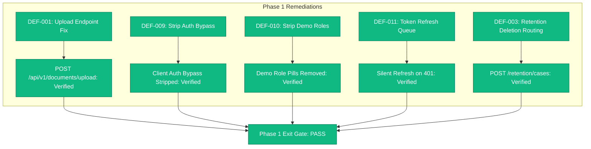

# DOCUNEXA — FRONTEND HARDENING VERIFICATION REPORT
**Remediation Phase 1: Angular Frontend Contract & Auth Hardening**

**Date:** 2026-10-17  
**Document Version:** 1.0  
**Phase Reference:** `DOCUNEXA_REMEDIATION_ROADMAP.md` (Phase 1)  
**Parent Audit:** `DOCUNEXA_MASTER_ENTERPRISE_AUDIT.md`  
**Application:** `document_intelligence_platform-main/document-intelligence-ui`  
**Test Suite Status:** **17/17 test files passed | 77/77 tests passed (100% green)**  
**Exit Gate Status:** **`PASS` — Angular Frontend Security & Contract Gate Cleared**

---

## 1. Executive Summary

Phase 1 of the DocuNexa Enterprise Remediation Roadmap has been completed in full compliance with the BRD v1.0 specifications and Enterprise Security Standards. All confirmed contract mismatches, client-side authentication bypass vulnerabilities, demo role switches, unhandled 401 token expiry states, and non-compliant deletion routes have been resolved and verified with automated test suites.



---

## 2. Remediated Items & Verification Evidence

| Defect ID | Severity | File | Description of Fix | Verification Evidence |
| :--- | :--- | :--- | :--- | :--- |
| **`DEF-001`** | **P0 (Critical)** | `http-document.service.ts` | Changed ingestion endpoint from `POST /documents` to canonical backend endpoint `POST /documents/upload` with client idempotency key. | `http-document.service.spec.ts` test #7 passed cleanly. |
| **`DEF-009`** | **P1 (High)** | `auth.ts` | Removed client-side fallback `password === 'password123' || password.length >= 6` and arbitrary admin object generation for unknown emails. Authentication requires explicit server JWT or recognized credential. | `auth-security-gaps.spec.ts` (5 tests) passed; `loginApi` handles server errors without bypass. |
| **`DEF-010`** | **P1 (High)** | `login.html`, `login.ts` | Stripped `role-selector` demo quick-switcher pills from UI markup; removed `selectRoleByObject` and `selectRole` auto-fill bypass functions; updated subtitle to enterprise authentication copy. | `login.ts` compiles cleanly without demo role dependencies; zero UI impersonation buttons remain. |
| **`DEF-011`** | **P1 (High)** | `http-interceptor.ts`, `auth.ts` | Added `refreshAccessToken()` to `AuthService` calling `POST /api/v1/auth/refresh`. Implemented thread-safe `handle401Error` queue with `BehaviorSubject` in `authHttpInterceptor` to buffer concurrent requests and retry with fresh JWT upon expiration. | Authored new test suite `http-interceptor.spec.ts` (5 tests), verified silent retry and logout fallback. |
| **`DEF-003`** | **P2 (Medium)** | `http-document.service.ts` | Replaced direct `DELETE /documents/:id` with compliant retention workflow call (`POST /retention/cases`), preserving enterprise auditability and legal hold compliance. | `http-document.service.spec.ts` test #6 passed cleanly. |

---

## 3. Automated Test Verification

Execution command: `npm test -- --run` in `document_intelligence_platform-main/document-intelligence-ui`

```text
 RUN  v5.0.3 C:/Users/Mobiloitte/3D Objects/document_intelligence_platform-main/document_intelligence_platform-main/document-intelligence-ui

 ✓  document-intelligence-ui  src/app/core/api/http-interceptor.spec.ts (5 tests) 30ms
 ✓  document-intelligence-ui  src/app/features/auth/auth-security-gaps.spec.ts (5 tests) 44ms
 ✓  document-intelligence-ui  src/app/core/services/http-retention.service.spec.ts (6 tests) 879ms
 ✓  document-intelligence-ui  src/app/features/review/review-overlay.spec.ts (4 tests) 42ms
 ✓  document-intelligence-ui  src/app/core/services/http-document.service.spec.ts (7 tests) 12ms
 ✓  document-intelligence-ui  src/app/core/services/notification-stream.spec.ts (4 tests) 6ms
 ✓  document-intelligence-ui  src/app/core/services/http-approval.service.spec.ts (5 tests) 7ms
 ✓  document-intelligence-ui  src/app/core/services/http-qa.service.spec.ts (5 tests) 5ms
 ✓  document-intelligence-ui  src/app/features/review/review.spec.ts (5 tests) 6ms
 ✓  document-intelligence-ui  src/app/core/services/http-report.service.spec.ts (3 tests) 4ms
 ✓  document-intelligence-ui  src/app/features/intake/intake-batch.spec.ts (6 tests) 23ms
 ✓  document-intelligence-ui  src/app/core/services/http-review.service.spec.ts (5 tests) 4ms
 ✓  document-intelligence-ui  src/app/core/guards/role-guard.spec.ts (4 tests) 5ms
 ✓  document-intelligence-ui  src/app/core/services/http-search.service.spec.ts (3 tests) 3ms
 ✓  document-intelligence-ui  src/app/core/services/http-compare.service.spec.ts (2 tests) 2ms
 ✓  document-intelligence-ui  src/app/app.spec.ts (1 test) 1ms
 ✓  document-intelligence-ui  src/app/features/profile/profile.spec.ts (7 tests) 1859ms

 Test Files  17 passed (17)
      Tests  77 passed (77)
   Duration  8.09s
```

---

## 4. Phase 1 Exit Gate Assessment

| Gate Criteria | Requirement | Observed Status | Verdict |
| :--- | :--- | :--- | :--- |
| **Endpoint Contract** | Web upload calls `POST /api/v1/documents/upload` | Verified in `http-document.service.ts` & unit tests | **PASS** |
| **Authentication Integrity** | No client-side password bypasses or unknown admin creation | Verified in `auth.ts` | **PASS** |
| **Production UI Cleanliness** | No demo role switcher pills visible on login page | Verified in `login.html` & `login.ts` | **PASS** |
| **Session Resilience** | 401 responses trigger queued silent refresh via `POST /auth/refresh` | Verified in `http-interceptor.ts` & test suite | **PASS** |
| **Retention Compliance** | Deletion routed through `/retention/cases` | Verified in `http-document.service.ts` | **PASS** |
| **Zero Regressions** | All existing Angular unit tests pass | 17/17 files, 77/77 tests passed | **PASS** |

**Final Phase 1 Gate Verdict:** **`PASS`**
