# FRONTEND TO FLUTTER TRACEABILITY MATRIX — DOCUNEXA PLATFORM

**Target Repository:** `document_intelligence_platform-main`  
**Angular Source:** `document-intelligence-ui` (14 feature modules, 33 views, 27 services)  
**Target Mobile App:** DocuNexa Mobile (Flutter / Dart, Android First)  
**Date:** 2026-10-16  
**Auditor:** Principal Software Architect & Senior Flutter Engineer  
**Status:** RECONCILED & UPDATED (Sprint 0E Deliverable)  
**Reconciliation Cross-References:** [`PHASE_3_GAP_ANALYSIS.md`](file:///c:/Users/Mobiloitte/3D%20Objects/document_intelligence_platform-main/docs/audit/PHASE_3_GAP_ANALYSIS.md), [`FLUTTER_MOBILE_PARITY_GAP_ANALYSIS.md`](file:///c:/Users/Mobiloitte/3D%20Objects/document_intelligence_platform-main/docs/audit/FLUTTER_MOBILE_PARITY_GAP_ANALYSIS.md)

---

## 1. Executive Strategy & Mobile Architectural Paradigms

Migrating DocuNexa's enterprise web application to a high-performance Flutter mobile application requires adapting wide-viewport desktop paradigms (e.g., multi-column data grids, 50/50 split-screen review workbenches, side-by-side version diffing) into touch-optimized, ergonomic mobile workflows without losing business rules, security boundaries, or API fidelity.

### 1.1 Architecture & State Management
- **State Management:** BLoC / Cubit pattern (`flutter_bloc`) with immutable states (`freezed` or `equatable`).
- **Network Layer:** `Dio` client configured with:
  - `AuthInterceptor`: Attaches `Authorization: Bearer <accessToken>` and handles 401 token refresh queuing.
  - `CorrelationInterceptor`: Generates and propagates `x-correlation-id` UUIDs on every outgoing request.
  - `RetryInterceptor`: Transparent retry with exponential backoff on 502/503/504 network errors.
- **Secure Persistence:** `flutter_secure_storage` for JWT access and refresh tokens; `shared_preferences` for non-sensitive UI settings; `sqflite` or `drift` for offline document caching and draft task queues.
- **Navigation:** `go_router` supporting declarative routes, role-based guard redirects, deep-linking, and bottom navigation bar state retention.
- **Design System:** Material 3 `ThemeData` replicating Angular CSS custom properties:
  - Primary: Deep Indigo (`#4F46E5` / `#4338CA`)
  - Background Dark: Slate-900 (`#0F172A`), Slate-800 (`#1E293B`)
  - Accent / Status: Emerald (`#10B981`), Amber (`#F59E0B`), Rose (`#F43F5E`), Sky (`#0284C7`)
  - Typography: Google Fonts `Inter` scale.

---

## 2. Complete Screen-by-Screen Traceability Matrix

The table below maps all 33 Angular views across all 14 feature modules to their Flutter mobile equivalents, defining state management, API routes, UX adaptations, and business rules.

| # | Angular Route & Component | Role Access | Flutter Screen & Route | Mobile UX & Layout Adaptation | BLoC / State Manager | Backend API Endpoints | Migration Notes & Business Rules |
| :-: | :--- | :--- | :--- | :--- | :--- | :--- | :--- |
| **1** | `/login` `Login` | Public | `/login` `LoginScreen` | Clean single-column layout, password visibility toggle, biometric prompt if enrolled, SMS/Email OTP toggle. **Remove demo quick-login buttons.** | `AuthBloc` (`LoginRequested`, `OtpRequested`, `BiometricLoginRequested`) | `POST /api/v1/auth/login` `POST /api/v1/auth/request-otp` `POST /api/v1/auth/verify-otp` | Removes client-side password bypass (`auth.ts`). Enforces lockout timer locally and via backend 429 response. |
| **2** | `/verify-email` `VerifyEmail` | Public | `/verify-email` `VerifyEmailScreen` | 6-box auto-focusing numeric OTP pin input widget with resend cooldown countdown timer. | `AuthBloc` (`VerifyEmailSubmitted`, `ResendOtpRequested`) | `POST /api/v1/auth/verify-otp` `POST /api/v1/auth/request-otp` | Auto-submits on 6th digit entry. Handles expired OTP gracefully. |
| **3** | `/reset-password` `ResetPassword` | Public | `/reset-password` `ResetPasswordScreen` | Stepper form: Step 1 = Request reset link/OTP; Step 2 = Enter token and new password with real-time complexity meters. | `AuthBloc` (`PasswordResetRequested`, `PasswordResetConfirmed`) | `POST /api/v1/auth/request-password-reset` `POST /api/v1/auth/confirm-password-reset` | Enforces 12-char minimum, uppercase, lowercase, number, and special character checks before enabling submit. |
| **4** | `/access-denied` `AccessDenied` | Public | `/access-denied` `AccessDeniedScreen` | Full-screen empty state with shield illustration, error explanation, and "Return to Dashboard" action button. | Stateless Widget | N/A | Triggered by `go_router` redirect when user role lacks required permissions. |
| **5** | `/accept-invite` `AcceptInvite` | Public | `/accept-invite` `AcceptInviteScreen` | Onboarding flow reading token from deep-link URI (`docunexa://invite?token=...`), full name confirmation, and initial password creation. | `AuthBloc` (`AcceptInviteSubmitted`) | `POST /api/v1/auth/accept-invite` | Deep-link routing parsed via `go_router` query parameters. |
| **6** | `/dashboard` `Dashboard` | All Authenticated | `/dashboard` `DashboardScreen` (Tab 0) | Mobile dashboard with pull-to-refresh: KPI metric cards (horizontal carousel), intake shortcut FAB, recent activity list, and processing queue mini-summary. | `DashboardBloc` (`LoadDashboardData`, `RefreshDashboard`) | `GET /api/v1/reports/kpis` `GET /api/v1/documents?limit=5` `GET /api/v1/review/queue?limit=5` | Combines KPI stats and recent documents. Implements shimmer loading skeletons. |
| **7** | `/documents` `Documents` | Tenant Roles | `/documents` `DocumentCatalogScreen` (Tab 1) | Infinite scroll card list replacing desktop table. Filter chips (Status, Type, Date Range), search bar header, multi-select action sheet. | `DocumentCatalogBloc` (`FetchDocuments`, `FilterChanged`, `SearchQueryChanged`) | `GET /api/v1/documents` | Pagination via cursor or page/limit. Pull-to-refresh and swipe actions (Share, Archive, Retry). |
| **8** | `/documents/:id` `DocumentDetail` | Tenant Roles | `/documents/:id` `DocumentDetailScreen` | Tabbed mobile view: Tab 1 = Overview & Metadata; Tab 2 = Extracted Fields & Confidence; Tab 3 = Processing Timeline; Tab 4 = Versions. Floating action for PDF preview. | `DocumentDetailBloc` (`LoadDocumentDetail`, `RetryDocumentProcessing`) | `GET /api/v1/documents/:id` `POST /api/v1/documents/:id/retry` `GET /api/v1/documents/:id/pages/1/image` | Displays raw extracted JSON in expandable key-value tree; shows confidence color badges (Green >= 90%, Amber 70-89%, Red < 70%). |
| **9** | `/intake` `Intake` | Contributor, Reviewer, Approver, Admin | `/intake` `IntakeScreen` | Floating Action Button or dedicated Tab. Multi-source file picker: Document scanner (Camera via `image_picker`), Local File Picker (`file_picker`), and Cloud Drives. Upload progress bar per file. | `IntakeBloc` (`FileSelected`, `DocumentTypeChanged`, `UploadSubmitted`) | **`POST /api/v1/documents/upload`** (Corrected from buggy `/documents`) | Fixes `DEF-001`. Multi-part form data upload with background upload support via `WorkManager` or foreground notification service. |
| **10** | `/review` `Review` | Reviewer, Org Admin | `/review` `ReviewQueueScreen` (Tab 2) | Triage work queue with priority tabs (High, Medium, Low), SLA countdown timers, and quick review status tags (Pending, In Progress, Blocked). | `ReviewQueueBloc` (`LoadQueue`, `QueueFilterChanged`) | `GET /api/v1/review/queue` | Displays document name, document type, low-confidence field count, and assigned reviewer. |
| **11** | `/review/:id` `ReviewWorkbench` | Reviewer, Org Admin | `/review/:id` `ReviewWorkbenchScreen` | Replaces desktop 50/50 split screen with **Swipeable Dual-Panel or Bottom Sheet Viewer**: Top 55% = Pinch-to-zoom interactive document image with overlaid bounding box rectangles; Bottom 45% (draggable) = Field correction form with confidence badges and OCR text matching. | `ReviewWorkbenchBloc` (`LoadWorkbench`, `FieldCorrected`, `DecisionSubmitted`, `BoundingBoxSelected`) | `GET /api/v1/review/workbench/:id` `PATCH /api/v1/review/:id/fields/:key` `POST /api/v1/review/:id/decision` | Touch target scaling: Bounding boxes scaled using devicePixelRatio and document page dimensions. Supports "Approve", "Reject", and "Mark Exception" decisions. |
| **12** | `/compare` `CompareStudio` | Tenant Roles | `/compare` `CompareSelectorScreen` | Document pair selector modal/screen allowing selection of Base Document vs Target Document or Version A vs Version B. | `CompareBloc` (`SelectBaseDoc`, `SelectCompareDoc`, `ExecuteCompare`) | `GET /api/v1/documents?limit=20` | Simple selector interface leading into Diff Screen. |
| **13** | `/compare/:id` `CompareStudio` | Tenant Roles | `/compare/:id` `CompareDiffScreen` | Replaces desktop side-by-side with **Unified Diff View or Tabbed Toggle** (Document A / Document B / Unified Diff). Colored highlighting: Green for additions, Red for deletions, Yellow for modified values. | `CompareBloc` (`ExecuteCompare`) | `POST /api/v1/compare` | Semantic and text diffing with summary badge (e.g., "94% similarity, 3 clauses altered"). |
| **14** | `/approvals` `Approvals` | Approver, Org Admin | `/approvals` `ApprovalsQueueScreen` (Tab 3) | Approval card queue showing pending requests, approval tier (Tier 1 / Tier 2 / Executive), total value / risk score, and SLA status. Swipe right to approve, swipe left to reject. | `ApprovalsBloc` (`LoadApprovalsQueue`, `SubmitApprovalDecision`) | `GET /api/v1/approvals/queue` `POST /api/v1/approvals/:id/decide` | Confirmation bottom sheet required for Rejections (mandatory reason prompt) and Approvals. Audit signature attached. |
| **15** | `/search` `Search` | Tenant Roles | `/search` `SearchScreen` | Full-screen search with search history, voice search input, filter chips (Semantic vs Keyword), and highlighted text snippets with relevance scores. | `SearchBloc` (`QuerySubmitted`, `SearchModeToggled`, `ClearHistory`) | `GET /api/v1/search?query=...&mode=...` | Debounced query input (300ms). Tap result navigates directly to `/documents/:id`. |
| **16** | `/qa` `Qa` | Tenant Roles | `/qa` `QaChatScreen` | Conversational messaging interface (like Slack/WhatsApp). User messages on right, AI assistant responses on left with expandable source citation chips and "Verify Citation" preview modal. | `QaBloc` (`SendMessage`, `VerifyCitationRequested`, `ClearChat`) | `POST /api/v1/qa/ask` `POST /api/v1/qa/verify-citation` | Streaming response support via Server-Sent Events or chunked HTTP response. Citation tap highlights the exact bounding box on the referenced document page. |
| **17** | `/tasks` `Tasks` | Contributor, Reviewer, Approver, Admin | `/tasks` `TaskManagementScreen` | Segmented control: "My Tasks" / "Assigned by Me" / "All". Card list with task priority colors, due date badges, and quick status picker (Pending, In Progress, Completed). | `TaskBloc` (`LoadTasks`, `TaskStatusUpdated`, `CreateTask`) | `GET /api/v1/tasks` `POST /api/v1/tasks` `PATCH /api/v1/tasks/:id` | Floating Action Button to create task; tap task opens Task Detail Sheet with comments. |
| **18** | `/reports` `Reports` | All Roles | `/reports` `ReportsAnalyticsScreen` | Mobile analytics dashboard using `fl_chart`: Accuracy trends (Line Chart), Processing Volume (Bar Chart), Error Breakdown (Pie Chart), and Date Range selector bottom sheet. | `ReportsBloc` (`LoadAnalytics`, `DateRangeChanged`) | `GET /api/v1/reports/kpis` `GET /api/v1/reports/accuracy` `GET /api/v1/reports/export` | Export PDF/CSV trigger saves to device downloads folder using `path_provider` and opens system share dialog. |
| **19** | `/profile` `Profile` | All Roles | `/profile` `UserProfileScreen` (Tab 4) | User avatar with camera upload badge, name, email, role badge, Biometric Unlock toggle, Change Password button, Active Sessions card list, and MFA setup flow. | `ProfileBloc` (`LoadProfile`, `UploadAvatar`, `RevokeSession`, `ToggleBiometrics`) | `GET /api/v1/users/profile` `POST /api/v1/users/profile/avatar` `POST /api/v1/auth/change-password` `DELETE /api/v1/auth/sessions/:id` | Biometric local enrollment stored securely in device hardware keystore. Active session revocation updates immediately. |
| **20** | `/admin/overview` `AdminOverview` | Org Admin, Platform Operator | `/admin/overview` `AdminTelemetryScreen` | High-level system vitals: Storage utilization gauge, active background workers count, uptime percentage, and service health indicators. | `AdminBloc` (`LoadTelemetry`) | `GET /api/v1/admin/telemetry` `GET /api/v1/health/live` | Color-coded health badges (Green/Yellow/Red). Pull-to-refresh. |
| **21** | `/admin/users` `AdminUsers` | Org Admin | `/admin/users` `UserDirectoryScreen` | Searchable user directory with role badges and active/inactive status switches. FAB to invite new user via modal sheet. | `UserManagementBloc` (`LoadUsers`, `InviteUser`, `UpdateUserRole`, `ToggleUserStatus`) | `GET /api/v1/admin/users` `POST /api/v1/admin/users/invite` `PATCH /api/v1/admin/users/:id` | Includes tenant-scoped validation and role selector dropdown. |
| **22** | `/admin/document-types` `AdminDocumentTypes` | Org Admin | `/admin/document-types` `DocTypesCatalogScreen` | Card list of configured document types (Invoices, Receipts, Contracts, Passports) with version counters and active schema toggle. | `DocTypeAdminBloc` (`LoadDocTypes`, `ToggleDocType`) | `GET /api/v1/admin/document-types` | Tap card navigates to Schema Builder Screen. |
| **23** | `/admin/document-types/:id` `AdminSchemaBuilder` | Org Admin | `/admin/document-types/:id` `SchemaBuilderScreen` | Reorderable field list (`ReorderableListView`): Field Name, Data Type (Text, Number, Date, Amount), Mandatory toggle, Regex pattern editor bottom sheet. | `SchemaBuilderBloc` (`LoadSchema`, `AddField`, `UpdateField`, `ReorderFields`, `SaveSchema`) | `GET /api/v1/admin/document-types/:id` `PUT /api/v1/admin/document-types/:id/schema` | Includes validation bounds and sample regex tester modal. |
| **24** | `/admin/workflow` `AdminWorkflow` | Org Admin | `/admin/workflow` `WorkflowRulesScreen` | Multi-tier approval thresholds and automated assignment rule cards with edit sheet. | `WorkflowAdminBloc` (`LoadRules`, `UpdateRule`) | `GET /api/v1/admin/workflow/rules` `PUT /api/v1/admin/workflow/rules` | Configures document value thresholds requiring Tier 2 / Tier 3 approvals. |
| **25** | `/admin/retention` `AdminRetention` | Org Admin | `/admin/retention` `RetentionPoliciesScreen` | Retention schedule list (e.g. 7 years for Tax documents) with Legal Hold toggle and purge request audit history. | `RetentionAdminBloc` (`LoadPolicies`, `SetLegalHold`) | `GET /api/v1/admin/retention` `POST /api/v1/admin/retention/legal-hold` | Destructive purge actions require multi-factor re-authentication or typing confirmation keyword. |
| **26** | `/admin/security` `AdminSecurity` | Org Admin | `/admin/security` `SecuritySettingsScreen` | Role permission matrix (collapsible accordions), PII masking rule toggles, and session idle timeout selector. | `SecurityAdminBloc` (`LoadSecurityConfig`, `SaveSecurityConfig`) | `GET /api/v1/admin/security/policies` `PUT /api/v1/admin/security/policies` | Controls whether field-level PII is masked for Reviewers and Viewers. |
| **27** | `/admin/integrations` `AdminIntegrations` | Org Admin | `/admin/integrations` `IntegrationsScreen` | Connector cards (SAP, Salesforce, QuickBooks, Webhooks, IMAP) with connection status badges, test ping action, and configuration modal. | `IntegrationsBloc` (`LoadIntegrations`, `TestWebhook`, `SaveConnector`) | `GET /api/v1/admin/integrations` `POST /api/v1/admin/integrations/:id/test` | Secure API key entry with masked text field. |
| **28** | `/admin/notifications` `AdminNotifications` | Org Admin, Platform Operator | `/admin/notifications` `NotificationConfigScreen` | Notification template list (Email, Push, In-App), event trigger toggles, and recipient role checkboxes. | `NotificationAdminBloc` (`LoadTemplates`, `SaveTemplate`) | `GET /api/v1/admin/notifications/templates` `PUT /api/v1/admin/notifications/templates` | Allows editing message templates with dynamic variable tokens (`{{doc_name}}`, `{{author}}`). |
| **29** | `/admin/ai-quality` `AdminAiQuality` | Org Admin | `/admin/ai-quality` `AiQualityBenchmarkScreen` | Golden set evaluation benchmark trigger, benchmark history card list, and F1 score / Precision / Recall progress bars. | `AiQualityBloc` (`RunBenchmark`, `LoadBenchmarkHistory`) | `GET /api/v1/admin/ai-quality/benchmarks` `POST /api/v1/admin/ai-quality/run` | Displays accuracy percentages and highlighted extraction failures. |
| **30** | `/admin/audit` `AdminAudit` | Org Admin, Platform Operator | `/admin/audit` `AuditLedgerScreen` | Immutable chronological audit ledger with hash verification badges, event type filter chips, and actor identity pills. | `AuditLedgerBloc` (`LoadLedger`, `VerifyLedgerIntegrity`) | `GET /api/v1/admin/audit` `POST /api/v1/admin/audit/verify` | Green checkmark badge indicates cryptographic hash chain is valid; red badge indicates tampering. |
| **31** | `/admin/reports` `AdminReports` | Org Admin | `/admin/reports` `TenantReportsScreen` | Enterprise aggregate reporting: SLA adherence rate, throughput velocity, user productivity leaderboards. | `ReportsAdminBloc` (`LoadTenantReports`) | `GET /api/v1/admin/reports/summary` | Filterable by department, team, and date range. |
| **32** | `/admin/operations` `AdminOperations` | Platform Operator, Org Admin | `/admin/operations` `OperationsDashboardScreen` | Dead letter queue monitor, failed OCR background jobs, manual retry action button, and worker concurrency controls. | `OperationsBloc` (`LoadFailedJobs`, `RetryJob`, `PurgeQueue`) | `GET /api/v1/admin/operations/queue` `POST /api/v1/admin/operations/queue/retry-all` | Allows batch re-queuing of stuck or timed-out document processing jobs. |
| **33** | `/admin/trace` `AdminTrace` | Admin, Operator, Auditor | `/admin/trace` `TraceViewerScreen` | Distributed transaction trace visualizer: Timeline stepper showing ingestion -> OCR -> classification -> extraction -> validation -> storage with latency breakdowns per span. | `TraceBloc` (`LookupTrace`, `LoadTraceDetails`) | `GET /api/v1/admin/trace/:correlationId` | Input field for `x-correlation-id` UUID lookup; interactive timeline nodes expand with request payloads. |

---

## 3. Flutter Mobile Navigation Structure

To provide an ergonomic experience on phone form factors, the 33 web screens are organized into a clear hierarchical navigation architecture:

```mermaid
graph TD
    AppShell[App Shell - GoRouter]
    AppShell --> AuthStack[Authentication Stack]
    AppShell --> MainNavBar[Main Bottom Navigation Bar]
    AppShell --> AdminDrawer[Enterprise Admin Drawer]

    AuthStack --> S1[LoginScreen]
    AuthStack --> S2[VerifyEmailScreen]
    AuthStack --> S3[ResetPasswordScreen]
    AuthStack --> S5[AcceptInviteScreen]

    MainNavBar --> Tab0[Tab 0: DashboardScreen]
    MainNavBar --> Tab1[Tab 1: DocumentCatalogScreen]
    MainNavBar --> Tab2[Tab 2: ReviewQueueScreen]
    MainNavBar --> Tab3[Tab 3: ApprovalsQueueScreen]
    MainNavBar --> Tab4[Tab 4: UserProfileScreen]

    Tab0 --> FAB[FAB: IntakeScreen]
    Tab1 --> S8[DocumentDetailScreen]
    Tab1 --> S12[CompareStudioScreen]
    Tab1 --> S15[SearchScreen]
    Tab1 --> S16[QaChatScreen]
    Tab1 --> S17[TaskManagementScreen]
    Tab1 --> S18[ReportsAnalyticsScreen]

    Tab2 --> S11[ReviewWorkbenchScreen]
    Tab3 --> S14[ApprovalDetailSheet]

    AdminDrawer --> A1[AdminTelemetryScreen]
    AdminDrawer --> A2[UserDirectoryScreen]
    AdminDrawer --> A3[DocTypesCatalogScreen]
    AdminDrawer --> A4[WorkflowRulesScreen]
    AdminDrawer --> A5[RetentionPoliciesScreen]
    AdminDrawer --> A6[SecuritySettingsScreen]
    AdminDrawer --> A7[IntegrationsScreen]
    AdminDrawer --> A8[NotificationConfigScreen]
    AdminDrawer --> A9[AiQualityBenchmarkScreen]
    AdminDrawer --> A10[AuditLedgerScreen]
    AdminDrawer --> A11[OperationsDashboardScreen]
    AdminDrawer --> A12[TraceViewerScreen]
```

---

## 4. Cross-Cutting Engineering Standards for Mobile

### 4.1 Token Lifecycle & Refresh Flow
The Angular frontend fails to refresh expired tokens (`DEF-006` / P1), logging users out on HTTP 401. The Flutter mobile app implements an automated, queue-backed refresh flow in `Dio`:
1. When any request returns `401 Unauthorized`, `AuthInterceptor` pauses outbound requests.
2. It calls `POST /api/v1/auth/refresh` using the secure `refreshToken`.
3. If refresh succeeds, the new `accessToken` is stored in `FlutterSecureStorage` and queued requests are retried with the new token.
4. If refresh fails (token revoked/expired), the app purges credentials and triggers `AuthBloc(LoggedOut)`, smoothly transitioning to the login screen.

### 4.2 Camera & Document Scanning Integration
Angular's web intake relies on drag-and-drop file upload. Flutter introduces native mobile capabilities:
- **Edge Detection & Scanning:** Integrates camera feed with auto-cropping and perspective correction.
- **Image Compression:** Pre-compresses high-resolution camera captures (target: JPEG <= 2MB, 300 DPI) before upload to save mobile bandwidth.
- **Multipart Upload:** Direct streaming upload to `POST /api/v1/documents/upload` with real-time percentage progress indicators.

### 4.3 Review Workbench Touch UX
The desktop review workbench uses a 50/50 horizontal split. On mobile:
- Top panel uses `InteractiveViewer` with smooth pinch-to-zoom, pan, and double-tap reset.
- Bounding box overlay layer uses `CustomPainter` rendering normalized coordinates `(x, y, w, h)` multiplied by rendered image canvas size.
- Tapping a field in the bottom panel auto-scrolls and centers the document viewer on the corresponding bounding box with a pulsating highlight.

---

## 5. Traceability Audit Sign-Off

All 14 Angular feature modules and 33 view states are completely mapped to Flutter screens with explicit state managers, backend routes, UX adaptations, and business logic preservation.
