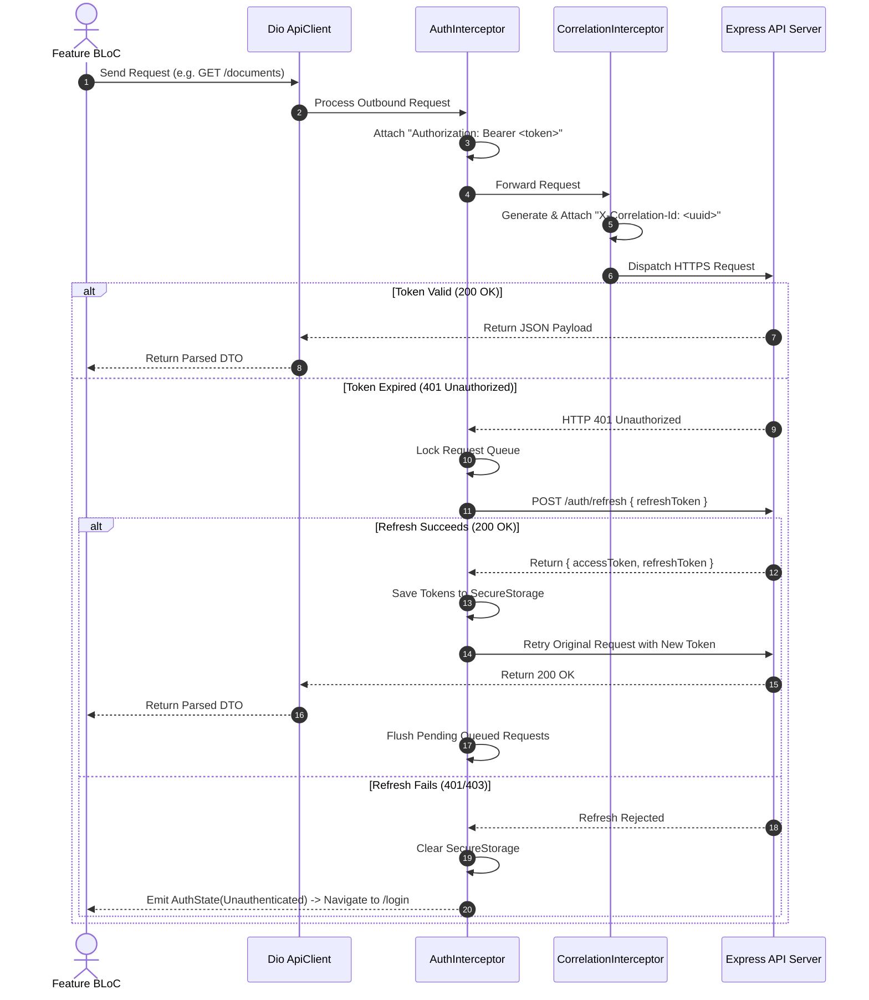

# API INTEGRATION PLAN — DOCUNEXA MOBILE

**Client Library:** `Dio` (v5.x)  
**API Specification:** RESTful JSON / OpenAPI 3.1.0 Compatible  
**Base Path:** `/api/v1`  
**Error Standard:** RFC 7807 / RFC 9457 Problem Details  
**Date:** 2026-10-16  

---

## 1. Environment & Base URL Configuration

The mobile application utilizes compile-time environment flavors configured via Dart defines (`--dart-define`):

| Flavor | Environment | Base API URL | TLS Certificate Pinning | Logging Level |
| :--- | :--- | :--- | :---: | :---: |
| **Development** | Local / Docker Sandbox | `http://10.0.2.2:8080/api/v1` (Android Emulator) / `http://localhost:8080/api/v1` (iOS) | Disabled | Verbose (Curl, Headers, Body) |
| **Staging** | Staging Cloud Cluster | `https://staging-api.docunexa.com/api/v1` | Enabled | Info / Error Only |
| **Production** | Production Multi-Tenant Cloud | `https://api.docunexa.com/api/v1` | Enforced | Warning / Error Only |

---

## 2. Cross-Cutting HTTP Interceptor Architecture



### 2.1 Queued Token Refresh Implementation Details
To resolve `DEF-011` / `SEC-009`, the `AuthInterceptor` extends `QueuedInterceptor`:
- When an API call returns `401 Unauthorized`:
  1. The interceptor locks the client to prevent parallel requests from triggering multiple refresh calls.
  2. A dedicated isolated `Dio` instance calls `POST /api/v1/auth/refresh`.
  3. If successful, new tokens are saved in `FlutterSecureStorage`, the original request's headers are updated, and the request is retried.
  4. If refresh fails (token revoked or expired), all queued calls are rejected and an unauthenticated event is broadcast.

### 2.2 Mutation Idempotency Header
For non-idempotent mutations:
- `POST /documents/upload`
- `POST /approvals/:id/decision`
- `PATCH /review/:id/fields/:key`
- `POST /users/invite`

The client automatically generates and attaches an `Idempotency-Key: <UUIDv4>` header. If a network interruption occurs, re-transmitting the request with the identical key prevents double processing.

---

## 3. Canonical Endpoint Mapping for Mobile

| Mobile Feature Slice | HTTP Method & Verified Path | Expected Request Payload / Params | Expected Response Schema | Error Handling Strategy |
| :--- | :--- | :--- | :--- | :--- |
| **Auth** | `POST /auth/login` | `{ email, password, mfaCode? }` | `200 { accessToken, refreshToken, user }` | Map 401 (Invalid creds) / 429 (Rate limit). |
| **Auth** | `POST /auth/request-otp` | `{ email }` | `200 { success: true, expiresInSeconds }` | (Sprint 0D verified: `testOtp` leak eliminated). |
| **Auth** | `POST /auth/verify-otp` | `{ email, code }` | `200 { accessToken, refreshToken, user }` | Map 400 (Invalid/Expired code). |
| **Auth** | `POST /auth/refresh` | `{ refreshToken }` | `200 { accessToken, refreshToken, expiresIn }` | On 401: purge session, force login. |
| **Intake** | `POST /documents/upload` | `multipart/form-data: file, documentType` | `202 { jobId, documentId, status: 'QUEUED' }` | **Fixes DEF-001.** Handle 409 `DUPLICATE_DOCUMENT`. |
| **Catalog** | `GET /documents` | Query: `limit, offset, status, type` | `200 { documents: [...], total }` | Pagination cursor support; skeleton shimmer. |
| **Detail** | `GET /documents/:id` | Path: `id` | `200 { document, versions, metadata }` | Handle 404 (Not found). |
| **Review** | `GET /review/queue` | Query: `priority, limit` | `200 { queue: [...], total }` | Pull-to-refresh; SLA color coding. |
| **Workbench** | `GET /review/workbench/:id` | Path: `id` | `200 { document, fields, boundingBoxes }` | Normalized coordinate parser. |
| **Workbench** | `PATCH /review/:id/fields/:key` | `{ value, boundingBox? }` | `200 { field, updatedConfidence: 1.0 }` | Debounced auto-save (500ms). |
| **Workbench** | `POST /review/:id/decision` | `{ decision, notes }` | `200 { status }` | Idempotent mutation. |
| **Approvals** | `GET /approvals/queue` | None | `200 { pendingApprovals: [...] }` | Role-filtered list. |
| **Approvals** | `POST /approvals/:id/decision` | `{ decision, comments }` | `200 { approvalStatus }` | Handle 403 `SOD_VIOLATION` (SoD guard). |
| **Comparison**| `POST /compare` | `{ baseDocumentId, targetDocumentId }` | `200 { similarityScore, diffs, summary }` | Compute Myers diff visual tags. |
| **Search** | `GET /search` | Query: `q, mode, limit` | `200 { results: [...], total }` | Debounced query (300ms). |
| **Q&A Chat** | `POST /qa/ask` | `{ question, documentIds? }` | `200 { answer, citations: [...], abstain }` | Groundedness check (`abstain == true`). |
| **Profile** | `GET /users/profile` | None | `200 { profile }` | Cache user preferences. |
| **Avatar** | `POST /users/profile/avatar` | `multipart/form-data: file` | `200 { avatarUrl }` | Image pre-compression (<= 512KB). |
| **Sessions** | `DELETE /auth/sessions/:id` | Path: `id` | `200 { success: true }` | Immediate session invalidation. |
| **Telemetry** | `GET /health/ready` | None | `200 { status, checks: { postgres, redis } }` | Service health status pills. |

---

## 4. Standardized Problem Details Error Mapping

All API errors conform to RFC 7807 and are parsed into strongly typed `AppException` classes:

```dart
class ProblemDetailsException implements Exception {
  final String type;
  final String title;
  final int status;
  final String detail;
  final String? instance;
  final String? correlationId;
  final Map<String, dynamic>? invalidParams;

  ProblemDetailsException({
    required this.type,
    required this.title,
    required this.status,
    required this.detail,
    this.instance,
    this.correlationId,
    this.invalidParams,
  });
}
```

User-facing snackbars and dialogs automatically display the friendly `detail` message along with the traceable `correlationId`.
