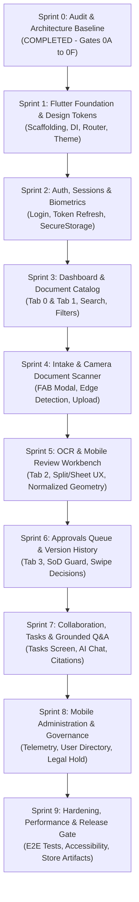

# FLUTTER MOBILE SPRINT ROADMAP & EXECUTION PLAN

**Application:** DocuNexa Mobile Client  
**Execution Sequence:** SPRINT 0 (AUDIT) -> SPRINT 1 TO SPRINT 9 (IMPLEMENTATION & HARDENING)  
**Governance Standard:** Plan -> Implement One Sprint -> Test -> Audit -> Release Gate Approval -> Next Sprint  
**Active Branch:** `mobile-frontend`  
**Date:** 2026-10-16  

---

## 1. Roadmap Overview & Dependency Graph

---

## 2. Detailed Sprint Specifications

### Sprint 1: Flutter Foundation, Design Tokens, Routing & Toolchain Setup
- **Objective:** Establish the Flutter mobile application structure, core design tokens, dependency injection container, routing shell, and verify compilation.
- **Dependencies:** Sprint 0F Architecture Approval; compatible Flutter/Dart SDK environment (`BLK-001`).
- **Features & Scope:**
  - Create project structure under `mobile/` or root directory per workspace topology.
  - Setup Material 3 Design System: Deep Indigo (`#4F46E5`), Slate-900 Dark Mode (`#0F172A`), GoogleFonts `Inter`.
  - Wire `GetIt` dependency injection in `lib/core/di/injection_container.dart`.
  - Configure `go_router` shell with 5 bottom navigation tabs and splash/error fallback routes.
  - Setup `Dio` base client with `CorrelationInterceptor` and Problem Details error parser.
- **Definition of Done:** Project builds without warnings; theme displays light/dark modes; unit tests for DI and router pass with 100% assertions.
- **Exit Gate:** `flutter test` passes 100%; basic app shell launches in emulator/device.

---

### Sprint 2: Authentication, Sessions, Biometrics & Profile
- **Objective:** Implement production-grade mobile authentication, token refresh queue, biometric unlock, and user profile management without web security bypasses.
- **Dependencies:** Sprint 1 Foundation complete; Backend `/auth` endpoints verified.
- **Features & Screens:**
  - Screens: `LoginScreen`, `VerifyEmailScreen`, `ResetPasswordScreen`, `AcceptInviteScreen`, `UserProfileScreen`.
  - Implement `AuthBloc` handling `LoginRequested`, `OtpRequested`, `LogoutRequested`.
  - Integrate `FlutterSecureStorage` for tokens and `local_auth` for biometric unlock.
  - Configure `QueuedInterceptor` in `Dio` to execute automatic token refresh on HTTP 401 (`DEF-011` / `SEC-009`).
  - **Omit web demo buttons and local password bypasses completely** (`DEF-009`, `DEF-010`).
- **Definition of Done:** Complete login -> refresh -> biometric unlock -> logout lifecycle verified with automated widget and integration tests.
- **Exit Gate:** 100% unit tests pass; negative authorization cases properly route to `/login`.

---

### Sprint 3: Executive Dashboard & Document Catalog Discovery
- **Objective:** Deliver operational insight and document browsing with infinite scrolling, search, and status filtering.
- **Dependencies:** Sprint 2 Auth & Session management complete.
- **Features & Screens:**
  - Screens: `DashboardScreen` (Tab 0), `DocumentCatalogScreen` (Tab 1), `DocumentDetailScreen`.
  - BLoCs: `DashboardBloc`, `DocumentCatalogBloc`, `DocumentDetailBloc`.
  - Implement KPI metric carousel, pull-to-refresh, recent activity feed.
  - Implement search bar header and filter chips (Document Type, Status, Date Range).
  - Tabbed document detail: Metadata overview, extracted fields, processing timeline.
- **Definition of Done:** Catalog loads paginated records from `GET /api/v1/documents`; skeleton loaders render during network latency.
- **Exit Gate:** Widget and BLoC tests pass; zero memory leaks during rapid pagination.

---

### Sprint 4: Document Intake, Native Camera Scanner & File Operations
- **Objective:** Enable high-resolution document ingestion via native camera scanning and file picker with byte-level progress tracking.
- **Dependencies:** Sprint 3 Catalog complete; verified backend endpoint `POST /api/v1/documents/upload` (`DEF-001`).
- **Features & Screens:**
  - Screen: `IntakeScreen` (Modal / FAB action).
  - BLoC: `IntakeBloc`.
  - Integrate `cunning_document_scanner` for automatic edge detection, cropping, and contrast enhancement.
  - Integrate `file_picker` for PDF, TIFF, PNG, and DOCX files.
  - Client-side 300 DPI pre-compression to optimize bandwidth.
  - Multipart upload streaming directly to `POST /api/v1/documents/upload` with percentage progress bar.
  - Handle HTTP 409 `DUPLICATE_DOCUMENT` with collision resolution bottom sheet.
- **Definition of Done:** Successful upload of multi-page camera scan and PDF files verified against backend database.
- **Exit Gate:** End-to-end ingestion test passes; SHA-256 hash collision test passes.

---

### Sprint 5: OCR, Extraction & Touch-Optimized Review Workbench
- **Objective:** Translate the desktop 50/50 split-screen review studio into an ergonomic mobile dual-panel workbench with normalized coordinate scaling.
- **Dependencies:** Sprint 4 Intake complete; backend review endpoints verified.
- **Features & Screens:**
  - Screens: `ReviewQueueScreen` (Tab 2), `ReviewWorkbenchScreen`.
  - BLoCs: `ReviewQueueBloc`, `ReviewWorkbenchBloc`.
  - Priority triage queue (High, Medium, Low) with SLA countdown timers.
  - **Swipeable Dual-Panel Workbench:** Top 55% = Pinch-to-zoom `InteractiveViewer` with document raster; Bottom 45% = Draggable field correction sheet.
  - Implement normalized coordinate ratio geometry ($[0.0, 1.0]$) to prevent bounding box scaling errors (`DEF-007`).
  - Real-time invoice math reconciliation (`Subtotal + Tax = Total`).
- **Definition of Done:** Reviewer can inspect document, select bounding box, edit field text, and submit review decision via `POST /api/v1/review/:id/decision`.
- **Exit Gate:** Visual bounding box alignment tests pass across multiple device screen densities.

---

### Sprint 6: Multi-Tier Approvals, Separation of Duties & Version History
- **Objective:** Implement mobile approval queues with swipe actions, strict financial Separation of Duties enforcement, and version comparison.
- **Dependencies:** Sprint 5 Review complete.
- **Features & Screens:**
  - Screens: `ApprovalsQueueScreen` (Tab 3), `ApprovalDetailSheet`, `CompareDiffScreen`.
  - BLoCs: `ApprovalsBloc`, `CompareDiffBloc`.
  - Card-based approval queue with swipe actions (swipe right = approve, swipe left = reject).
  - Enforce backend Separation of Duties guard: Uploader and Reviewer blocked from self-approval.
  - Unified version comparison viewer replacing desktop side-by-side view with colored diff chips.
  - Biometric re-authentication prompt before approving documents exceeding $50,000.
- **Definition of Done:** Document transitions from `REVIEWED` to `PUBLISHED` through verified approval decisions.
- **Exit Gate:** Separation of Duties negative test passes (HTTP 403 `SOD_VIOLATION` verified).

---

### Sprint 7: Collaboration, Task Management & Grounded Q&A Chat
- **Objective:** Enable task delegation, workflow comments, and conversational document question answering with verified citations.
- **Dependencies:** Sprint 6 Approvals complete.
- **Features & Screens:**
  - Screens: `TaskManagementScreen`, `QaChatScreen`.
  - BLoCs: `TaskBloc`, `QaBloc`.
  - Task board with status toggles (Pending, In Progress, Completed) and priority tags.
  - Conversational messaging UI with streaming text responses from `POST /api/v1/qa/ask`.
  - Verified citation pills: Tapping citation smoothly centers document viewer on referenced page coordinates.
- **Definition of Done:** Q&A answers include clickable citation tags; ungrounded questions return `abstain: true`.
- **Exit Gate:** Grounded citation integration test passes; task status updates persist.

---

### Sprint 8: Mobile-Appropriate Administration & Governance
- **Objective:** Deliver essential administrative monitoring and governance views tailored for mobile, while preserving web-only exclusions.
- **Dependencies:** Sprint 7 complete; backend admin telemetry endpoints verified.
- **Features & Screens:**
  - Screens: `AdminTelemetryScreen`, `UserDirectoryScreen`, `RetentionPoliciesScreen`, `OperationsDashboardScreen`.
  - High-level system vitals: Storage gauge, active worker counts, service status badges (Postgres, Redis).
  - Searchable user directory with role assignment bottom sheet.
  - Retention policy list with **Emergency Legal Hold Toggle**.
  - Dead-letter queue monitor with one-tap job retry button.
  - **Exclusions:** Informational cards for Schema Builder and Webhook Scripting directing users to DocuNexa Web.
- **Definition of Done:** Org Admins can monitor health, invite users, apply emergency legal holds, and retry stuck jobs from mobile.
- **Exit Gate:** Admin role guard tests pass; non-admins receive HTTP 403 / redirect to `/access-denied`.

---

### Sprint 9: Hardening, Performance Profiling & Release Readiness
- **Objective:** Conduct comprehensive security hardening, performance profiling, accessibility audits, and produce release builds.
- **Dependencies:** Sprints 1 through 8 complete.
- **Activities & Deliverables:**
  - OWASP Mobile Application Security Verification (MASVS Level 2) static and dynamic analysis.
  - Performance profiling: Verify cold start $\le 1.8$s, memory $\le 180$MB, 60 FPS scrolling.
  - Accessibility audit: Screen reader labels, touch targets $\ge 48 \times 48$dp, color contrast $\ge 4.5:1$.
  - Android App Bundle (`.aab`) and iOS release archive generation.
  - Documentation: Mobile Deployment Runbook and Store Submission Checklist.
- **Definition of Done:** Zero Critical/High defects; 100% automated test suite pass rate; release build signed with production keys.
- **Exit Gate:** Formal Sprint 9 Release Gate Sign-Off.
