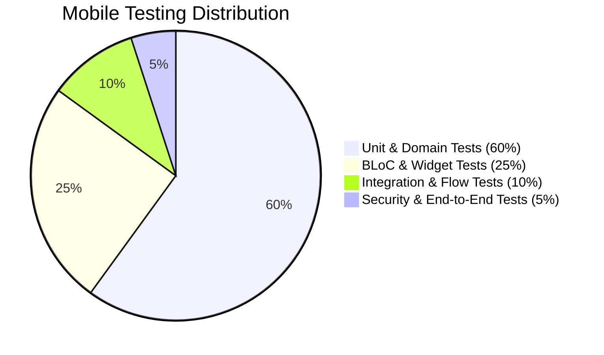

# FLUTTER MOBILE TEST STRATEGY — DOCUNEXA PLATFORM

**Application:** DocuNexa Mobile Client  
**Testing Frameworks:** `flutter_test`, `bloc_test`, `mocktail`, `integration_test`  
**Target Coverage:** $\ge 85\%$ Branch Coverage across Domain and Presentation Layers  
**Date:** 2026-10-16  

---

## 1. Testing Pyramid & Verification Tiers

The DocuNexa Mobile test architecture follows the standard enterprise testing pyramid:



1. **Unit & Domain Tests (60%):** Entity validation, repository data mapping, DTO JSON serialization/deserialization, Problem Details RFC 7807 error parsing, coordinate transformation geometry.
2. **BLoC & State Tests (25%):** Deterministic event-to-state stream testing using `bloc_test`. Verifies loading, success, error, and empty state transitions.
3. **Widget & Screen Tests (10%):** UI layout rendering, theme contrast, touch target dimensions, form input validation, skeleton loaders.
4. **Integration & E2E Tests (5%):** Complete user journeys (Login -> Upload Camera Scan -> Review Workbench Correction -> Submit Approval Decision).

---

## 2. Layer-Specific Testing Guidelines

### 2.1 BLoC Testing (`bloc_test`)
Every BLoC must have exhaustive unit tests covering all emitted state sequences:
```dart
blocTest<AuthBloc, AuthState>(
  'emits [AuthLoading, Authenticated] when LoginRequested succeeds',
  build: () {
    when(() => mockAuthRepo.login('user@docunexa.com', 'ValidPass123!'))
        .thenAnswer((_) async => tUser);
    return AuthBloc(authRepository: mockAuthRepo, secureStorage: mockStorage);
  },
  act: (bloc) => bloc.add(const LoginRequested('user@docunexa.com', 'ValidPass123!')),
  expect: () => [
    const AuthLoading(),
    Authenticated(user: tUser),
  ],
);
```

### 2.2 Network & Interceptor Verification
Specialized test suites must verify:
- **Token Refresh Race Condition:** 5 simultaneous HTTP 401 calls trigger exactly **one** call to `POST /auth/refresh`, and all 5 original calls resume with the new token.
- **Idempotency Key Injection:** Verified that every `POST /documents/upload` and `POST /approvals/:id/decision` has an `Idempotency-Key` UUID.
- **Correlation Propagation:** Verified that `X-Correlation-Id` is attached to 100% of outbound requests.

### 2.3 Coordinate Geometry & Bounding Box Scaling (Addressing DEF-007)
Unit tests must verify that coordinate transformations correctly scale across varying screen aspect ratios:
```dart
test('scales normalized [0.1, 0.2, 0.5, 0.8] to 360x640 canvas correctly', () {
  const normBox = NormalizedRect(left: 0.1, top: 0.2, right: 0.5, bottom: 0.8);
  const canvasSize = Size(360, 640);
  
  final scaled = normBox.toCanvasRect(canvasSize);
  
  expect(scaled.left, equals(36.0));
  expect(scaled.top, equals(128.0));
  expect(scaled.width, equals(144.0));
  expect(scaled.height, equals(384.0));
});
```

### 2.4 Separation of Duties (SoD) Negative Verification
Widget and integration tests must verify that when `currentUserId == document.uploaderId`:
- The approval action button is rendered in a disabled state with a tooltip warning: *"Separation of Duties: Uploader cannot approve own document"*.
- Any attempt to bypass the UI constraint results in HTTP 403 `SOD_VIOLATION` handling without crashing the client.

---

## 3. Automated Test Execution Commands

| Test Suite | Execution Command | Environment |
| :--- | :--- | :--- |
| **All Unit & BLoC Tests** | `flutter test --coverage` | Local / CI |
| **Feature Slices Only** | `flutter test test/features/auth/` | Local Dev |
| **Widget UI Tests** | `flutter test test/core/widgets/` | Local / CI |
| **Integration Suite** | `flutter test integration_test/app_flow_test.dart -d emulator-5554` | Connected Device / Emulator |
| **Coverage Report Generation**| `genhtml coverage/lcov.info -o coverage/html` | CI Pipeline |
