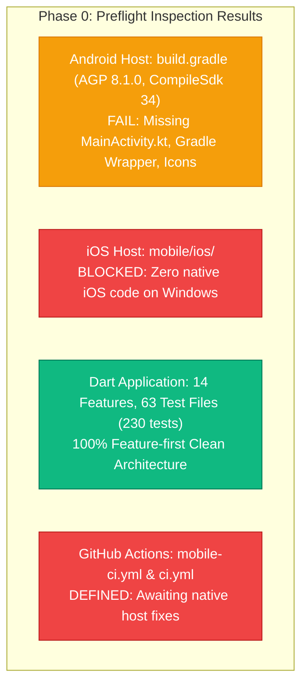

# DOCUNEXA FLUTTER MOBILE — PHASE 0 BASELINE & TOOLCHAIN AUDIT REPORT
**Preflight Inspection & Gap Register Baseline**

**Date:** 2026-10-17  
**Document Version:** 1.0  
**Phase Reference:** Phase 0 (Baseline and Toolchain Audit)  
**Parent Plan:** Master Gap Remediation and Release Verification Plan  
**Repository Path:** `mobile/`  
**Active Git Branch:** `mobile-frontend`  
**Host Limitation:** `BLK-001` — Windows workstation with Flutter/Dart SDK absent from `PATH`  
**Audit Mode:** Read-Only Source & Configuration Inspection

---

## 1. Executive Preflight Summary

In accordance with Phase 0 of the Master Gap Remediation Plan, a read-only audit of `mobile/`, its configuration files, native host directories, and CI workflows was performed. No application code or native assets were altered during this inspection.

---

## 2. Inventory of Actual Files & Inspection Findings

### 2.1 Dependencies & Package Lock (`mobile/pubspec.yaml`)
- **Package Name:** `docunexa_mobile` (version `0.1.0+1`)
- **SDK Constraints:** `sdk: ">=3.0.0 <4.0.0"`, `flutter: ">=3.16.0"`
- **Core Dependencies:**
  - State & Architecture: `flutter_bloc: ^8.1.3`, `get_it: ^7.6.7`, `equatable: ^2.0.5`
  - Networking: `dio: ^5.4.0`, `intl: ^0.19.0`
  - Routing: `go_router: ^14.0.0`
  - Security & Storage: `flutter_secure_storage: ^9.0.0`, `local_auth: ^2.1.8`
  - Intake & Hardware: `file_picker: ^8.0.0`, `cunning_document_scanner: ^1.4.0`
  - UI: `google_fonts: ^6.1.0`
- **Lockfile Status:** `mobile/pubspec.lock` is **absent** from the repository because `flutter pub get` has not been executed on this host workstation.

### 2.2 Android Native Host Inspection (`mobile/android/`)
- **Project Structure:**
  - `build.gradle`: Configures Google, Maven Central repositories and standard subproject build directory redirection.
  - `settings.gradle`: Configures Android Gradle Plugin (AGP) `8.1.0`, Kotlin `1.8.22`, and Flutter plugin loader. References `local.properties` for `flutter.sdk`.
  - `app/build.gradle`:
    - Namespace: `com.docunexa.mobile`
    - Compile SDK: `34`, Target SDK: `34`, Min SDK: `24`
    - Java/JVM Target: `JavaVersion.VERSION_1_8`
    - `shrinkResources: true`, `minifyEnabled: true` in release build type
    - Source directories: `main.java.srcDirs += 'src/main/kotlin'`
  - `app/src/main/AndroidManifest.xml`:
    - Package: `com.docunexa.mobile`
    - Application label: `DocuNexa`
    - Icon reference: `@mipmap/ic_launcher`
    - Activity: `android:name=".MainActivity"` with `@style/LaunchTheme`
    - Permissions: `INTERNET`, `ACCESS_NETWORK_STATE`, `CAMERA`, `USE_BIOMETRIC`, `USE_FINGERPRINT`
    - Network config: `@xml/network_security_config` (enforces HTTPS except for local development hosts `10.0.2.2`, `localhost`, `127.0.0.1`)
- **Confirmed Missing Android Host Files:**
  1. `app/src/main/kotlin/com/docunexa/mobile/MainActivity.kt` does not exist (`GAP-01`).
  2. `app/src/main/res/` contains only `xml/network_security_config.xml`. It lacks `values/styles.xml` (defining `LaunchTheme`) and all `mipmap-*/ic_launcher.png` densities (`GAP-02`).
  3. `gradlew`, `gradlew.bat`, and `gradle/wrapper/` are missing (`GAP-03`).

### 2.3 iOS Platform Inspection (`mobile/ios/`)
- **Directory Status:** `mobile/ios/` is **completely absent** from the repository (`GAP-04`).
- **Toolchain Constraint:** Creating the canonical Xcode project (`Runner.xcodeproj`, `Info.plist`, `Podfile`) cannot be generated natively from Windows without the Flutter CLI. A macOS host or CI runner must scaffold this project.

### 2.4 CI Workflows (`.github/workflows/`)
- `.github/workflows/mobile-ci.yml`:
  - Triggers on push/PR to `main`, `develop`, `mobile-frontend` for `mobile/**`.
  - Configured with `ubuntu-latest`, Java 17 LTS (`temurin`), Flutter `3.22.2`.
  - Executes: `flutter pub get` -> `flutter analyze` -> `flutter test` -> `flutter build appbundle --release --no-tree-shake-icons`.
  - **Operational Status:** Currently **BLOCKED** from succeeding at step `flutter build appbundle` due to missing `MainActivity.kt` and missing Android XML resources (`GAP-01`, `GAP-02`).
- `.github/workflows/ci.yml`:
  - Contains `backend-ci`, `frontend-ci`, `ios-ci` (mock runner ready), and `flutter-mobile-ci`.

---

## 3. Baseline Status of the 13 Reported Gaps

Using the mandatory status vocabulary (`VERIFIED`, `IMPLEMENTED_NOT_VERIFIED`, `BLOCKED`, `NOT_REQUIRED`, `OPEN`):

| Gap ID | Description | Layer | Initial Status | Root Cause & Dependency |
| :--- | :--- | :---: | :---: | :--- |
| **`GAP-01`** | Missing `MainActivity.kt` with `FlutterFragmentActivity` | Android | **OPEN** | Kotlin source directory absent; needed for `local_auth`. |
| **`GAP-02`** | Missing `styles.xml` and `@mipmap/ic_launcher` resources | Android | **OPEN** | `res/` only contains `xml/network_security_config.xml`. |
| **`GAP-03`** | Missing Gradle Wrapper (`gradlew`, `gradle-wrapper.jar`) | Android | **OPEN** | Wrapper scripts not checked in under `mobile/android/`. |
| **`GAP-04`** | Complete absence of `mobile/ios/` host project | iOS | **BLOCKED** | Windows workstation cannot execute iOS toolchain; requires macOS or CI runner. |
| **`GAP-05`** | Absence of `web/` and `windows/` desktop hosts | Desktop/Web | **NOT_REQUIRED** | Explicitly out of scope; dedicated Angular app exists. |
| **`GAP-06`** | Missing Android 13+ granular media permissions | Android | **OPEN** | `READ_MEDIA_IMAGES` not declared; storage fallback needs audit. |
| **`GAP-07`** | Missing iOS Privacy Manifest & Usage Descriptions | iOS | **BLOCKED** | Blocked on `GAP-04` (scaffolding of `mobile/ios/`). |
| **`GAP-08`** | Absence of Cloud Push Notifications (FCM / APNs) | Cloud Push | **BLOCKED** | Enterprise Firebase/Apple credentials not provisioned; SSE in-app notifications are operational. |
| **`GAP-09`** | No local encrypted relational database (SQLite/Drift) | Data Cache | **OPEN** | Credentials stored in `flutter_secure_storage`; document lists held in memory. |
| **`GAP-10`** | Proactive Page Raster Image Caching for Offline Review | Review UX | **OPEN** | `ReviewWorkbenchScreen` relies on online fetch via `getPageImageUrl`. |
| **`GAP-11`** | Deep-link routes for `/verify-email` and `/reset-password` | Navigation | **OPEN** | OTP handled inline in `LoginScreen`; standalone GoRouter paths not declared. |
| **`GAP-12`** | Web-Only Exclusions (Schema Builder, Webhook Editor) | Parity Scope | **NOT_REQUIRED** | Confirmed intentional desktop exclusions per BRD Section 3. |
| **`GAP-13`** | Host Flutter/Dart SDK unavailable on workstation (`BLK-001`)| Toolchain | **BLOCKED** | Workstation PATH lacks Flutter; mitigated via cloud CI. |

---

## 4. Phase 0 Gate Verdict & Next Steps

- **Phase 0 Status:** **`COMPLETED`**
- **Repository Inspection:** Verified read-only; zero uncommitted or destructive changes.
- **Immediate Next Step:** **Phase 1 — Android Native Host Remediation** (`GAP-01`, `GAP-02`, and `GAP-03`).

In accordance with the Phase Completion Protocol, work is stopped. Awaiting explicit user authorization before starting Phase 1.
