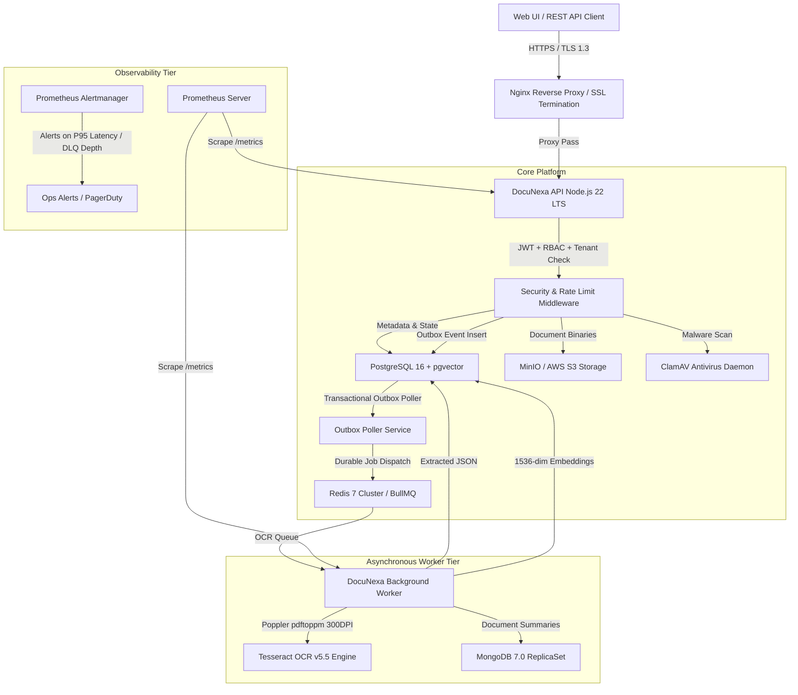

# DocuNexa — System Architecture Specification (Production Grade)

## 1. System Overview

**DocuNexa** is an enterprise-grade document intelligence and cognitive workflow automation platform designed for high-throughput, mission-critical legal, financial, and compliance operations.

---

## 2. Document Processing Pipeline

1. **Ingestion & Pre-Flight Security**:
   - Multi-part document upload via `POST /api/v1/documents`.
   - Streaming ClamAV malware scan. If infected, the file is immediately quarantined (`QUARANTINED` status) and rejected with `400 / 422`.
   - SHA-256 content hashing and file storage in S3/MinIO with tenant-prefixed storage paths (`tenants/<tenantId>/<documentId>/...`).
   - Atomic dual-write: Document row and `DOCUMENT_UPLOADED` transactional outbox event written in a single database transaction.

2. **Durable Decoupled Processing (Transactional Outbox + BullMQ)**:
   - The Outbox Poller queries pending events using `FOR UPDATE SKIP LOCKED` to prevent double-claiming across replica workers.
   - Dispatches jobs to Redis BullMQ queues (`ocr`, `extraction`, `webhook`, `email-intake`) with deterministic job IDs (`outbox-EVT-<id>`) ensuring exact-once deduplication.

3. **OCR & Spatial Geometry Normalization**:
   - PDF pages are rasterized to 300 DPI PPM/PNG images using Poppler `pdftoppm`.
   - Tesseract OCR v5.5 executes with TSV output mode to obtain genuine word/line coordinate bounding boxes.
   - Geometry is normalized into clock-wise 8-point polygons and 2D bounding boxes indexed by page number.
   - Text containing prompt injection attempts (e.g., `ignore previous instructions`, `SYSTEM OVERRIDE`) is stripped or quarantined before LLM processing.

4. **Information Extraction & Human-in-the-Loop Review**:
   - Template-driven extraction extracts structured schema fields (e.g., invoice numbers, line items, taxes, totals).
   - High-confidence extractions bypass review (Straight-Through Processing: `STP_PROCESSED`).
   - Low-confidence fields or arithmetic mismatches (e.g., net + tax != total) route the document to the Review Workbench (`NEEDS_REVIEW`).
   - Human reviewers correct fields; audit logs record the operator identity, previous value, corrected value, and reason.

5. **Storage & Multi-Model Persistence**:
   - **PostgreSQL 16**: Document metadata, relational audit logs, RBAC tables, tasks, review edits, legal holds, and 1536-dimensional semantic vector embeddings (`pgvector`).
   - **MongoDB 7**: Document summaries, raw multi-page JSON extraction trees, and golden-set evaluation runs.
   - **S3 / MinIO**: Immutable binary documents, high-resolution page rendering images, and export archives.

---

## 3. Multi-Tenancy & Security Isolation

- **Tenant Boundary Guard**: Every API route and background job validates `tenant_id` from the authenticated JWT token or outbox event payload.
- **Query Fence**: All PostgreSQL queries include `WHERE tenant_id = $1` filters. Composite indexes (e.g., `idx_documents_tenant_uploaded_at`) enforce tenant partition efficiency.
- **Fail-Closed Design**: If any security dependency (ClamAV, token verification, session validation) fails or is unreachable in production mode, requests fail closed (HTTP 503 or 401/403).
- **Credential Protection**: Automatic logging redaction prevents passwords, MFA secrets, authorization tokens, or IMAP credentials from appearing in logs or API response schemas.

---

## 4. Observability Architecture

- **Prometheus Metrics**: Scraped at `/metrics`, exposing:
  - `docunexa_http_request_duration_seconds` (p50, p95, p99 histograms)
  - `docunexa_queue_depth` by queue name
  - `docunexa_failed_jobs_total`
  - `docunexa_outbox_lag_seconds`
  - `docunexa_dual_write_failures_total`
- **Health Probes**:
  - `/health/live`: Unauthenticated liveness probe for Kubernetes / Docker Swarm restarts.
  - `/health/ready`: Deep readiness probe checking PostgreSQL, Redis, MongoDB, and S3 connectivity.
