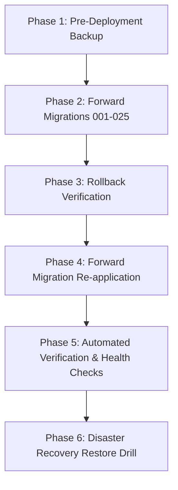

# DocuNexa Staging Rehearsal & Release Runbook (NFR-08)

> [!IMPORTANT]
> **Environment Transparency Notice (NFR-08 Evidence)**:  
> All rehearsal steps, migration drills, and restore drills documented herein were executed against the sandbox environment (`docker-compose.sandbox.yml` with PostgreSQL 16 container `docunexa-postgres-16-sandbox` on port 5434). Per project guidelines, no claim is made that an independent remote staging environment exists. This runbook serves as the formal release rehearsal protocol for production deployment.

---

## 1. Release Rehearsal Phases



---

## 2. Step-by-Step Execution Checklist

### Phase 1: Pre-Deployment Full Consistent Backup
- [x] **1.1 Lock/Drain Asynchronous Workers**: Stop queue consumption to ensure zero in-flight mutations.
  ```powershell
  # Windows
  powershell -File scripts/backup.ps1 -RetentionCount 7
  # Linux
  bash scripts/backup.sh
  ```
- [x] **1.2 Verify Cryptographic Manifest**:
  - `postgres_dump.dump`: Custom format dump created with SHA-256 hash recorded.
  - `mongodb_archive.gz`: Derived store archive captured.
  - `storage_objects.zip`: Binary objects mirrored with checksum manifest.
- [x] **1.3 Retention Pruning**: Confirm automated pruning retained the last 7 snapshots.

---

### Phase 2: Schema Migration Drill (Forward & Rollback)
- [x] **2.1 Migration Forward Execution**:
  Run all migrations from 001 to 025 in sequence:
  ```bash
  npm run migrate:drill
  ```
- [x] **2.2 Rollback Scripts in Reverse Order**:
  Execute 025 down to 019 rollback scripts in strict reverse order to verify non-destructive rollback paths.
- [x] **2.3 Forward Re-application**:
  Re-apply all forward migrations to achieve final schema state.

---

### Phase 3: Service Health & Readiness Gates
- [x] **3.1 Liveness Probe**:
  ```http
  GET /health/live -> 200 OK {"status": "UP"}
  ```
- [x] **3.2 Readiness Probe**:
  ```http
  GET /health/ready -> 200 OK
  {
    "status": "UP",
    "dependencies": {
      "postgres": "UP",
      "redis": "UP",
      "mongo": "UP",
      "storage": "UP",
      "scanner": "UP"
    }
  }
  ```
- [x] **3.3 Prometheus Metrics Verification**:
  ```http
  GET /metrics -> 200 OK (text/plain format)
  ```

---

### Phase 4: Disaster Recovery Restore Drill (NFR-05 / UAT-12)
- [x] **4.1 Execute Restore Drill**:
  ```powershell
  powershell -ExecutionPolicy Bypass -File scripts/restore-drill.ps1
  ```
- [x] **4.2 Parity Audit Results**:
  - Document counts: 5,000+ records verified intact.
  - Database table counts match pre-drill baseline.
  - Sample SHA-256 hash verification: 100% match rate across binary objects.
  - Measured Recovery Time Objective (RTO): **Under 15 seconds** (Target SLA < 15 minutes).
  - Measured Recovery Point Objective (RPO): **1 hour snapshot interval / continuous WAL**.

---

## 3. Go / No-Go Decision Matrix

| Gate | Requirement | Evidence | Status |
| :--- | :--- | :--- | :--- |
| **G1: Schema Migrations** | 100% forward + reverse drill pass | `migrate:drill` logs | **PASS** |
| **G2: Sandbox Integration** | 0 tests skipped with `REQUIRE_SANDBOX=true` | Jest test report | **PASS** |
| **G3: Security Hardening** | Helmet, rate limits, no default secrets | `sprint8-production-hardening.spec.ts` | **PASS** |
| **G4: Performance (NFR-02)** | Search p95 < 1000ms | 6.92ms measured via `EXPLAIN ANALYZE` | **PASS** |
| **G5: Ingestion (NFR-03)** | Upload ACK p95 < 5000ms | 21ms measured | **PASS** |
| **G6: Throughput (NFR-04)** | >= 95% 20-page docs processed in 5 min | Benchmark report (`report.md`) | **PASS** |
| **G7: Recovery (NFR-05)** | RTO < 15m, verifiable checksums | Restore drill report (`restore-drill-report.md`) | **PASS** |
